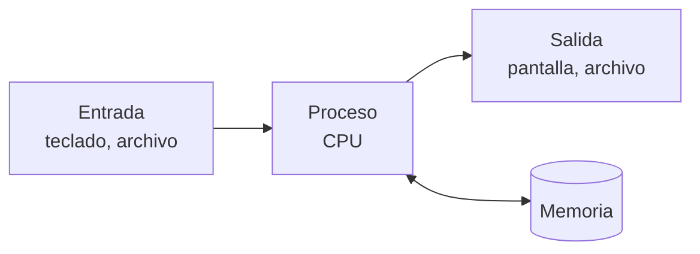
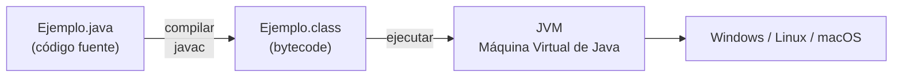

# Clase 1 · Del algoritmo a la primera clase en Java

> [!info] Datos de la clase
> **Duración:** 2 semanas de teoría · **IDE:** BlueJ · **Materia de apoyo:** Introducción a la Programación (INF-135, UMSS)
> **Material de la clase:** [[Clase 01 - Diapositivas|Diapositivas]] · [[Clase 01 - Práctica|Práctica]] · [[README|Ruta de aprendizaje]]

> [!abstract] Al terminar esta clase podrás…
> - Explicar qué es una computadora, el hardware, el software y por qué trabaja en binario.
> - Escribir un **algoritmo** con asignación, contador, acumulador, lectura, salida, condición y repetición.
> - Verificar un algoritmo con una **prueba de escritorio**.
> - Reconocer las partes de una **clase en Java** (atributos, constructor y métodos) y probarla en BlueJ.
> - Elegir el **tipo de dato** correcto y declarar, inicializar y usar **variables** y **constantes**.

---

## Semana 1 · Pensar como computadora

### 1. La computadora y el software

Una **computadora** es una máquina que recibe datos (**entrada**), los transforma siguiendo instrucciones (**proceso**) y entrega resultados (**salida**). También puede **almacenar** datos para usarlos después.



| Concepto | Qué es | Ejemplos |
|---|---|---|
| **Hardware** | La parte física, lo que se puede tocar | CPU, memoria RAM, disco, teclado, monitor |
| **Software** | Las instrucciones (programas) que le dicen al hardware qué hacer | Sistema operativo, BlueJ, tus programas en Java |
| **CPU** | El "cerebro": ejecuta las instrucciones una por una | Intel, AMD, ARM |
| **Memoria RAM** | Donde viven los datos **mientras** el programa se ejecuta | Tus variables |

> [!note] Generaciones de computadoras (en una línea cada una)
> 1.ª tubos de vacío · 2.ª transistores · 3.ª circuitos integrados · 4.ª microprocesadores · 5.ª computación paralela, redes e inteligencia artificial.

### 2. ¿Por qué binario?

Los circuitos de una computadora solo distinguen dos estados: **hay corriente / no hay corriente**. Por eso toda información se guarda con dos dígitos, **0 y 1** (bits).

- **1 bit** = un 0 o un 1.
- **1 byte** = 8 bits → puede representar $2^8 = 256$ valores distintos.
- Con $n$ bits se representan $2^n$ valores.

**Ejemplo: convertir 26 a binario** (dividir entre 2 y leer los residuos de abajo hacia arriba):

| División | Cociente | Residuo |
|---|---|---|
| 26 ÷ 2 | 13 | **0** |
| 13 ÷ 2 | 6 | **1** |
| 6 ÷ 2 | 3 | **0** |
| 3 ÷ 2 | 1 | **1** |
| 1 ÷ 2 | 0 | **1** |

$26_{10} = 11010_2$. Comprobación: $16 + 8 + 0 + 2 + 0 = 26$.

> [!tip] Esto vuelve a aparecer en Java
> Los rangos de los tipos de datos (`byte`, `int`, `long`…) dependen de **cuántos bits** usan. Y Java permite escribir `0b11010` para el 26 en binario.

### 3. Lenguajes de programación

| Nivel | Cómo se ve | Quién lo entiende |
|---|---|---|
| **Lenguaje máquina** | `10110000 01100001` | La CPU directamente |
| **Ensamblador** | `MOV AL, 61h` | Casi la CPU (traducción 1 a 1) |
| **Alto nivel** | `int edad = 20;` | Personas → necesita traducción |

Java es un lenguaje de **alto nivel**. El camino de tu código hasta ejecutarse es:



> [!important] La idea clave de Java
> El compilador no produce código para un sistema operativo concreto sino **bytecode**, que ejecuta la **JVM**. Por eso un mismo programa funciona en cualquier sistema operativo: *"escribe una vez, ejecuta en cualquier lugar"*.

- **Compilar** = revisar que el código esté **bien escrito** (sintaxis) y traducirlo.
- Que compile **no** garantiza que funcione bien: puede tener **errores de lógica**.

### 4. ¿Qué es un algoritmo?

Un **algoritmo** es una secuencia **finita** y **ordenada** de pasos que resuelve un problema. Es como una receta de cocina: pasos numerados, en orden, que terminan.

**Características de un buen algoritmo**

| Característica | Significa |
|---|---|
| **Finitud** | Termina después de un número finito (y razonable) de pasos |
| **Correctitud** | Resuelve el problema y cumple lo que se pide |
| **Robustez** | Contempla todos los casos, sin que se escape ningún detalle |
| **Completitud** | Tiene todo lo necesario para llegar a la solución |
| **Eficiencia** | Usa la menor cantidad de recursos (pasos, memoria) |
| **Eficacia** | Alcanza el objetivo |

**Pasos para resolver un problema**

1. **Análisis**: ¿qué datos tengo (entrada)? ¿qué debo obtener (salida)? ¿qué relación hay entre ellos?
2. **Diseño**: escribir el algoritmo.
3. **Prueba de escritorio**: simularlo a mano.
4. **Codificación**: traducirlo a Java.
5. **Prueba**: ejecutarlo con varios datos.

### 5. Los datos en la memoria

Imagina la memoria como un **casillero**: cada casilla tiene una **dirección** y un **contenido**. Para no trabajar con direcciones en binario, les ponemos **nombres**: las **variables**.

| Variable | Contenido |
|---|---|
| `S` | 100 |
| `C` | −1 |
| `P` | *basura* |
| `SUMA` | *basura* |

> [!warning] La memoria no empieza limpia
> Una casilla que no inicializaste tiene **basura**: restos de un trabajo anterior. Por eso siempre damos un **valor inicial** a las variables antes de usarlas.

### 6. Elementos básicos de un algoritmo

Usaremos la notación del pseudocódigo de la materia: `←` (o `<=`) significa **asignar**.

| Elemento | Notación | Qué hace |
|---|---|---|
| **Asignación directa** | `Z ← 7` | Guarda 7 en Z (el valor anterior se pierde) |
| **Asignación diferida** | `Z ← Z + 3` | Primero calcula la derecha, **después** guarda en la izquierda |
| **Contador** | `C ← 0` (una vez) · `C ← C + 1` (cada vez) | Cuenta de 1 en 1 |
| **Acumulador** | `S ← 0` (una vez) · `S ← S + X` (cada vez) | Va sumando valores |
| **Lectura** | `Leer X` | Pide un dato al usuario |
| **Salida** | `Mostrar "La suma es: ", S` | Muestra mensajes y resultados |
| **Condicional** | `Si A > B Entonces M ← A Sino M ← B` | Decide entre dos caminos |
| **Repetición** | `Si C < 10 Entonces Ir a 3` | Vuelve a un paso anterior |

> [!example] Ejemplo 1 · Suma de los números del 1 al 10
> ```text
> 1. C ← 0
> 2. S ← 0
> 3. C ← C + 1
> 4. S ← S + C
> 5. Si C < 10 Entonces Ir a 3
> 6. Mostrar "La suma es: ", S
> 7. FIN
> ```
> - `C` es un **contador**: genera 1, 2, 3, …, 10.
> - `S` es un **acumulador**: va sumando lo que genera `C`.
> - Los pasos 1 y 2 están **fuera** de la repetición: se ejecutan una sola vez.

> [!example] Ejemplo 2 · Factorial de X
> ```text
> 1. Leer X
> 2. F ← 1 : C ← 0
> 3. C ← C + 1 : F ← F * C
> 4. Si C < X Entonces Ir a 3
> 5. Mostrar "El factorial es: ", F
> 6. FIN
> ```
> ¿Por qué `F` empieza en **1** y no en 0? Porque si empezara en 0, `F * C` daría siempre 0.

### 7. Prueba de escritorio

Es **simular a mano** lo que haría la computadora: una tabla con una columna por variable, donde anotas cada valor nuevo paso a paso. Es **la etapa más importante**, porque te permite descubrir:

- pasos en el orden incorrecto,
- algo que falta o que sobra,
- repeticiones que se ejecutan una vez de más o de menos.

**Prueba de escritorio del Ejemplo 1** (solo las primeras vueltas):

| Paso | C | S | ¿C < 10? |
|---|---|---|---|
| 1–2 | 0 | 0 | |
| 3–4 | 1 | 1 | sí → ir a 3 |
| 3–4 | 2 | 3 | sí → ir a 3 |
| 3–4 | 3 | 6 | sí → ir a 3 |
| … | … | … | … |
| 3–4 | 10 | 55 | **no** → paso 6 |

Salida: `La suma es: 55` ✔️

> [!tip] ¿Con qué datos probar?
> 1. Primero, con datos **fáciles** para ver que funciona.
> 2. Después, busca datos que lo hagan **fallar** (cero, negativos, el límite exacto).
> 3. Si hay varios casos posibles, prueba **uno por cada caso**. Por ejemplo, para "APROBADO si nota ≥ 51, REPROBADO si nota < 50, CASO ESPECIAL entre 50 y 51" prueba con 70, 40 y 50.5.

---

## Semana 2 · Tu primera clase en Java

### 8. Preparar el entorno con BlueJ

Usaremos **BlueJ** porque deja **ver** los objetos y probar métodos sin escribir código extra.

1. Descarga BlueJ desde <https://www.bluej.org/> (ya trae su propio JDK de Java incluido).
2. Instálalo y ábrelo.
3. **Proyecto → Nuevo proyecto**. Crea una carpeta para el curso y un proyecto por tema (por ejemplo `Clase01`).
4. **Nueva clase** → escribe el nombre (empieza con **mayúscula**) → doble clic para abrir el editor.

> [!tip] Si usas otro IDE
> IntelliJ, NetBeans, Eclipse o VS Code también sirven. La lógica es la misma; solo cambia que para probar necesitarás un método `main` (lo vemos en la [[Clase 02 - Apuntes|Clase 2]]).

### 9. Clase y objeto

- Una **clase** es un **molde**: define de forma general qué **tiene** (propiedades) y qué **hace** (comportamiento) algo.
- Un **objeto** es una cosa concreta creada a partir del molde, con **sus propios valores**.

> [!example] Clase `Auto` → objetos
> Todo auto tiene **color** y **marca** (eso lo dice la clase). Pero *mi* auto es rojo y Toyota, y el *tuyo* es azul y Nissan (esos son objetos). Ambos nacieron del mismo molde.

### 10. Estructura de una clase

Cuando creas una clase en BlueJ, aparece una plantilla como esta (traducida):

```java
/**
 * Escribe aquí una descripción de la clase Ejemplo.
 */
public class Ejemplo {
    // 1) ATRIBUTOS (variables de instancia)
    private int x;

    // 2) CONSTRUCTOR: crea objetos y da valores iniciales
    public Ejemplo() {
        x = 0;
    }

    // 3) MÉTODOS: lo que el objeto sabe hacer
    /**
     * Un ejemplo de método.
     * @param y  un parámetro de ejemplo
     * @return   la suma de x más y
     */
    public int metodoEjemplo(int y) {
        return x + y;
    }
}
```

| Parte | Para qué sirve |
|---|---|
| `public class Ejemplo { … }` | Declara la clase. Todo lo demás vive **dentro** de sus llaves |
| **Atributos** | Las características de cada objeto (también llamados *campos*, *propiedades* o *variables de instancia*) |
| **Constructor** | Tiene el **mismo nombre que la clase** y **no** tiene tipo de retorno. Su único trabajo es crear el objeto e **inicializar** los atributos |
| **Métodos** | Las acciones. Pueden recibir datos (**parámetros**) y devolver un resultado (`return`) |

**Bloques:** cada par de llaves `{ }` abre un **bloque**. Hay un bloque de la clase, uno del constructor y uno por cada método.

**Palabras reservadas:** las que BlueJ pinta de otro color (`public`, `class`, `int`, `return`…). Tienen un significado fijo y **no** puedes usarlas como nombres.

**Comentarios:**

```java
// comentario de una línea
/* comentario
   de varias líneas */
/** comentario de documentación (Javadoc):
    BlueJ lo muestra en la vista de documentación (Ctrl+J) */
```

### 11. Probar en BlueJ: objetos e inspector

1. **Compilar** (botón *Compile*). Si hay errores, BlueJ marca la línea.
2. Clic derecho sobre la clase → `new Ejemplo()` → ponle un nombre (`objeto1`). Aparece una ficha roja abajo: **ese es tu objeto**.
3. Doble clic sobre el objeto → **Inspector**: ves el **estado** (los valores de sus atributos).
4. Clic derecho sobre el objeto → elige un **método** → si pide parámetros, escríbelos → BlueJ muestra el **valor devuelto**.

> [!warning] Devolver ≠ imprimir
> Cuando un método hace `return`, **entrega** un valor que otro código puede usar. Imprimir (`System.out.println`) solo lo **muestra** en pantalla. No es lo mismo.

### 12. Tipos de datos

Cada variable tiene un **tipo** que indica la naturaleza del valor que guarda.

#### Primitivos numéricos enteros

| Tipo | Bits | Rango | Uso típico |
|---|---|---|---|
| `byte` | 8 | −128 a 127 | Datos muy pequeños |
| `short` | 16 | −32 768 a 32 767 | Poco usado |
| **`int`** | 32 | −2 147 483 648 a 2 147 483 647 | **El entero por defecto** |
| `long` | 64 | ≈ ±9,2 × 10¹⁸ | Números enormes. Requiere sufijo `L` |

#### Primitivos numéricos con decimales

| Tipo | Bits | Nota |
|---|---|---|
| `float` | 32 | Precisión simple. Requiere sufijo `F`: `4.5F` |
| **`double`** | 64 | **El decimal por defecto**. Sufijo `D` opcional |

#### Otros primitivos

| Tipo | Guarda | Literal |
|---|---|---|
| `boolean` | `true` o `false` | `boolean esValido = true;` |
| `char` | **un** carácter (letra, dígito, símbolo) | Comillas **simples**: `'D'` |

#### `String`: el tipo no primitivo que más usarás

```java
String nombre = "Unicornio";   // comillas DOBLES
```

`String` **no** es primitivo: es una **clase** que Java ya trae (por eso no se pinta como las palabras reservadas y empieza con mayúscula). Una cadena es una secuencia de `char`.

```java
byte   edad      = 20;
short  anio      = 1998;
int    codigo    = 202_400_123;     // los "_" solo ayudan a leer
long   poblacion = 8_000_000_000L;  // sin la L: "integer number too large"
float  tiempo    = 4.5F;            // sin la F: "possible lossy conversion"
double medida    = 1234.5678;
boolean aprobado = true;
char   inicial   = 'D';
String carrera   = "Ing. de Sistemas";
```

> [!warning] Errores típicos del compilador
> - `byte b = 288;` → *incompatible types: possible lossy conversion from int to byte* (no cabe).
> - `long x = 9000000000;` → *integer number too large* (falta la `L`).
> - `float f = 4.5;` → *possible lossy conversion from double to float* (falta la `F`).
> - `char c = D;` → *cannot find symbol* (faltan las comillas simples).

#### `char` es, por dentro, un número

Cada carácter tiene un código numérico (tabla **ASCII**/Unicode). Java permite usarlos indistintamente:

| Carácter | Código |
|---|---|
| `'0'` … `'9'` | 48 … 57 |
| `'A'` … `'Z'` | 65 … 90 |
| `'a'` … `'z'` | 97 … 122 |

```java
char letra = 68;          // guarda 'D'
char h = 'h', a = 'a';
System.out.println(h - a);       // 7  (resta de códigos)
System.out.println((char) 112);  // p
```

> [!tip] Esto sale en exámenes
> El **cifrado César** de un parcial de INF-135 se resuelve justamente con esta idea: las letras son números y se pueden sumar, restar y volver a convertir a `char`.

#### Curiosidades útiles para leer código ajeno

```java
int millon = 1_000_000;  // separador visual
int hex    = 0x1A;       // 26 en hexadecimal
int bin    = 0b11010;    // 26 en binario
```

### 13. Variables

Una **variable** es un **espacio en memoria con nombre** (identificador) que guarda un valor de un tipo.

```java
int edad;          // DECLARACIÓN: "va a existir edad"
edad = 20;         // ASIGNACIÓN: guarda 20
int nota = 75;     // DECLARACIÓN + INICIALIZACIÓN en una línea
int dia = 24, mes = 3;   // varias del mismo tipo en una línea
```

El `=` es el **operador de asignación**: lo de la **derecha** se guarda en la **izquierda**. No significa "igual" (eso es `==`).

#### Reglas y convenciones de nombres

| Regla (si no la cumples, no compila) | Convención (compila, pero no es correcto) |
|---|---|
| Letras, dígitos, `_` y `$` | Variables y métodos en `camelCase`: `notaFinal` |
| No puede empezar con un dígito | Clases en `PascalCase`: `CuentaBancaria` |
| No puede ser una palabra reservada | Constantes en `MAYUSCULAS`: `NOTA_MINIMA` |
| Distingue mayúsculas: `nota` ≠ `Nota` | Nombres que digan lo que guardan: `precio`, no `p` |

#### Alcance (*scope*)

Una variable **solo existe dentro del bloque donde se declaró** (y en los bloques que están dentro de él).

```java
public class Alcance {
    private int suma;            // atributo: visible en TODA la clase

    public void calcular(int a) { // a: parámetro, vive en el método
        int resta = a - 1;        // variable local, vive en el método
        suma = a + 1;             // ✔ puedo usar el atributo aquí
    }

    public int otro() {
        return resta;             // ✘ ERROR: resta no existe aquí
    }
}
```

| Tipo de variable | Dónde se declara | Cuánto vive |
|---|---|---|
| **Atributo** (de instancia, campo, *field*) | En la clase, fuera de los métodos | Lo que vive el objeto |
| **Parámetro** | Entre los paréntesis de un método | Lo que dura la llamada al método |
| **Local** (temporal) | Dentro de un método | Hasta que se cierra su bloque |

> [!warning] Locales sin valor
> Los **atributos** reciben un valor por defecto (`0`, `0.0`, `false`, `null`). Las **variables locales no**: si usas una sin inicializar, el compilador te avisa *variable might not have been initialized*.

#### Constantes

Si un valor **no debe cambiar**, se antepone `final`:

```java
final double GRAVEDAD = 9.8;
GRAVEDAD = 10;   // ✘ ERROR: cannot assign a value to final variable
```

### 14. Del pseudocódigo a Java

| Pseudocódigo | Java |
|---|---|
| `S ← 0` | `int s = 0;` |
| `C ← C + 1` | `c = c + 1;` |
| `M ← A` | `m = a;` |
| `Mostrar S` | `System.out.println(s);` |
| `Leer X` | `x = sc.nextInt();` (lo vemos en la [[Clase 02 - Apuntes|Clase 2]]) |

> [!example] Una clase completa con lo de esta clase
> ```java
> public class Estudiante {
>     private String nombre;
>     private int nota1;
>     private int nota2;
>     private final int NOTA_MINIMA = 51;
>
>     public Estudiante() {
>         nombre = "Sin nombre";
>         nota1 = 0;
>         nota2 = 0;
>     }
>
>     public int getNotaMinima() {
>         return NOTA_MINIMA;
>     }
> }
> ```
> Compílala, crea un objeto e inspecciónalo: verás `nombre`, `nota1` y `nota2` con sus valores iniciales.

---

## Resumen

> [!summary] Lo esencial de la Clase 1
> - Una computadora procesa **entrada → proceso → salida** y trabaja en **binario**.
> - Java se compila a **bytecode** y se ejecuta en la **JVM**.
> - Un **algoritmo** es finito y ordenado. Se construye con asignación, contador, acumulador, lectura, salida, condicional y repetición.
> - La **prueba de escritorio** es una tabla con los valores de las variables, paso a paso.
> - Una clase tiene **atributos + constructor + métodos**. Un objeto es una copia concreta de la clase.
> - Tipos por defecto: **`int`** para enteros, **`double`** para decimales. `long` lleva `L` y `float` lleva `F`. `char` va con `'…'`, `String` con `"…"`.
> - Una variable vive **solo en su bloque**. `final` la vuelve constante.

## Para profundizar

- 🎥 Videos de apoyo: [[Videos del curso#Clase 1|lista de videos de la Clase 1]]
- 📖 Glosario: [[Glosario]]
- ✍️ Siguiente paso: [[Clase 01 - Práctica]]
- ➡️ Siguiente clase: [[Clase 02 - Apuntes]]
