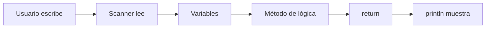
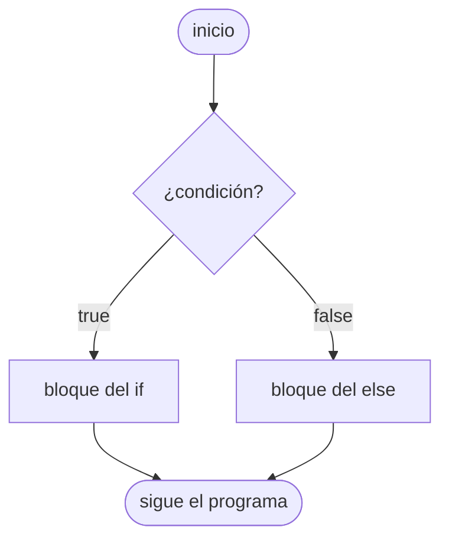

# Clase 2 · Operadores, métodos y decisiones

> [!info] Datos de la clase
> **Duración:** 2 semanas de teoría · **IDE:** BlueJ · **Requisito:** [[Clase 01 - Apuntes|Clase 1]]
> **Material de la clase:** [[Clase 02 - Diapositivas|Diapositivas]] · [[Clase 02 - Práctica|Práctica]] · [[README|Ruta de aprendizaje]]

> [!abstract] Al terminar esta clase podrás…
> - Escribir y **evaluar expresiones** con operadores aritméticos, relacionales y lógicos, respetando la precedencia.
> - Evitar las trampas típicas: **división entera**, `++` antes y después, comparar `String` con `==`.
> - **Convertir tipos** (*casting*) y usar la clase `Math`.
> - Escribir **métodos** con parámetros y valor de retorno, y entender `void` y `static`.
> - Leer datos con **`Scanner`** desde un método `main`.
> - Tomar decisiones con **`if`, `if-else`, `else if`** y el operador ternario.

---

## Semana 3 · Expresiones y operadores

Una **expresión** es una combinación de valores, variables y operadores que **se evalúa** y produce **un** valor.

```java
int total = precio * cantidad + envio;   // expresión aritmética → int
boolean puedeVotar = edad >= 18;          // expresión relacional → boolean
```

### 1. Operadores aritméticos

| Operador | Operación | Ejemplo | Resultado |
|---|---|---|---|
| `+` | suma | `7 + 2` | `9` |
| `-` | resta | `7 - 2` | `5` |
| `*` | multiplicación | `7 * 2` | `14` |
| `/` | división | `7 / 2` | `3` ⚠️ |
| `%` | módulo (residuo) | `7 % 2` | `1` |

#### ⚠️ La trampa de la división entera

Si **los dos operandos son enteros**, el resultado es **entero** (se descarta la parte decimal), **sin importar** dónde lo guardes.

```java
int    a = 10 / 3;     // 3
double b = 10 / 3;     // 3.0  ← ¡sigue siendo división entera!
double c = 10.0 / 3;   // 3.3333333333333335 ✔
double d = (double) 10 / 3; // 3.3333333333333335 ✔ (casting)
```

> [!important] Regla de oro
> El tipo del resultado lo deciden los **operandos**, no la variable donde lo guardas. Para obtener decimales, al menos **uno** de los operandos tiene que ser `double`.

#### El operador módulo `%`

`n % m` devuelve **lo que sobra** de dividir `n` entre `m`.

```text
   10 | 3
   -9   3   ← cociente:  10 / 3 = 3
   --
    1       ← residuo:   10 % 3 = 1
```

Es uno de los operadores más útiles en los ejercicios de la materia:

| Para… | Expresión | Ejemplo |
|---|---|---|
| Saber si `n` es **par** | `n % 2 == 0` | `8 % 2` → `0` |
| Saber si `d` **divide** a `n` | `n % d == 0` | `15 % 5` → `0` |
| Obtener el **último dígito** | `n % 10` | `427 % 10` → `7` |
| **Quitar** el último dígito | `n / 10` | `427 / 10` → `42` |
| "Dar la vuelta" (reloj, días) | `(h + k) % 24` | `(22 + 5) % 24` → `3` |

> [!example] Descomponer un número de 3 cifras
> ```java
> int n = 427;
> int unidades = n % 10;          // 7
> int decenas  = (n / 10) % 10;   // 2
> int centenas = n / 100;         // 4
> ```

### 2. Asignación compuesta

| Forma corta | Equivale a |
|---|---|
| `x += 5;` | `x = x + 5;` |
| `x -= 5;` | `x = x - 5;` |
| `x *= 5;` | `x = x * 5;` |
| `x /= 5;` | `x = x / 5;` |
| `x %= 5;` | `x = x % 5;` |

El **contador** y el **acumulador** de la Clase 1 se escriben así: `c += 1;` y `s += x;`.

### 3. Incremento y decremento: `++` y `--`

`x++` y `++x` suman 1 a `x`. La diferencia está en **qué valor entregan** a la expresión:

| Forma | Nombre | Se lee | Qué pasa |
|---|---|---|---|
| `x++` | post-incremento | "úsame y **después** cámbiame" | entrega el valor **viejo**, luego suma 1 |
| `++x` | pre-incremento | "cámbiame y **después** úsame" | suma 1, luego entrega el valor **nuevo** |

```java
int suma = 2;
int v1 = suma++;   // v1 = 2, suma = 3
int v2 = ++suma;   // suma = 4, v2 = 4
```

> [!tip] Consejo práctico
> Usa `x++` **solo** en su propia línea (`contador++;`). Dentro de expresiones más largas confunde y es fuente de errores.

### 4. Operadores relacionales

Comparan dos valores y **siempre** devuelven un `boolean`. Léelos como **preguntas**.

| Operador | Pregunta | Ejemplo | Resultado |
|---|---|---|---|
| `==` | ¿son iguales? | `5 == 5` | `true` |
| `!=` | ¿son distintos? | `23 != 7` | `true` |
| `>` | ¿es mayor? | `5 > 3` | `true` |
| `<` | ¿es menor? | `5 < 3` | `false` |
| `>=` | ¿es mayor o igual? | `5 >= 5` | `true` |
| `<=` | ¿es menor o igual? | `5 <= 3` | `false` |

> [!warning] `=` no es `==`
> `=` **asigna** un valor. `==` **pregunta** si dos valores son iguales.

> [!danger] Comparar `String`: usa `.equals()`
> ```java
> String a = "java";
> if (a.equals("java")) { … }            // ✔ compara el contenido
> if (a.equalsIgnoreCase("JAVA")) { … }  // ✔ sin importar mayúsculas
> if (a == "java") { … }                 // ✘ compara referencias: a veces falla
> ```
> `String` es una clase (no primitivo); `==` compara si son **el mismo objeto**, no si tienen el mismo texto.

### 5. Operadores lógicos

Sirven para **unir preguntas**. Trabajan con valores `boolean`.

| Operador | Nombre | Es `true` cuando… | Lenguaje natural |
|---|---|---|---|
| `&&` | Y (AND) | **todas** las condiciones son `true` | "es lunes **y** son las 8 → trabajo" |
| `\|\|` | O (OR) | **al menos una** es `true` | "la cancha de fútbol **o** la de vóley está abierta → hago deporte" |
| `!` | NO (NOT) | invierte el valor | "**no** llueve" |

**Tabla de verdad**

| `a` | `b` | `a && b` | `a \|\| b` | `!a` |
|---|---|---|---|---|
| `true` | `true` | `true` | `true` | `false` |
| `true` | `false` | `false` | `true` | `false` |
| `false` | `true` | `false` | `true` | `true` |
| `false` | `false` | `false` | `false` | `true` |

```java
boolean enRango   = nota >= 0 && nota <= 100;
boolean esVocal   = c == 'a' || c == 'e' || c == 'i' || c == 'o' || c == 'u';
boolean esImpar   = !(n % 2 == 0);
```

> [!tip] Evaluación en cortocircuito
> En `a && b`, si `a` es `false`, Java **ni mira** `b` (ya sabe que el resultado es `false`). En `a || b`, si `a` es `true`, tampoco mira `b`. Eso permite escribir con seguridad: `divisor != 0 && n % divisor == 0`.

> [!warning] No confundas `&&` con `&`
> `&`, `|`, `^`, `~`, `<<`, `>>` son operadores **a nivel de bits**. Existen, pero no son parte de esta materia. Si escribes `&` por error, a veces compila y da resultados inesperados.

### 6. Precedencia: ¿qué se evalúa primero?

De **mayor** a **menor** prioridad (los de la misma fila se evalúan de izquierda a derecha):

| Prioridad | Operadores |
|---|---|
| 1 | `( )` paréntesis |
| 2 | `++` `--` `!` `-` (unario) · *casting* `(int)` |
| 3 | `*` `/` `%` |
| 4 | `+` `-` |
| 5 | `<` `>` `<=` `>=` |
| 6 | `==` `!=` |
| 7 | `&&` |
| 8 | `\|\|` |
| 9 | `?:` (ternario) |
| 10 | `=` `+=` `-=` … (asignación, de derecha a izquierda) |

> [!example] Evaluación paso a paso
> `3 + 4 * 2 > 10 && 7 % 2 == 1`
> 1. `4 * 2` → `8`, y `7 % 2` → `1`
> 2. `3 + 8` → `11`
> 3. `11 > 10` → `true`, y `1 == 1` → `true`
> 4. `true && true` → **`true`**

> [!tip] Ante la duda, paréntesis
> `(a + b) / 2` y `a + b / 2` son cosas distintas. Los paréntesis hacen el código más claro aunque no sean obligatorios.

### 7. Conversión de tipos (*casting*)

- **Implícita (ensanchamiento):** de un tipo "pequeño" a uno "grande", Java lo hace solo.
  `byte → short → int → long → float → double` · `char → int`
- **Explícita (*casting*):** de "grande" a "pequeño" debes pedirlo tú, y **puedes perder información**.

```java
int    entero  = 7;
double real    = entero;          // 7.0  (implícita)
double precio  = 9.99;
int    truncado = (int) precio;   // 9    (explícita: corta, NO redondea)
long   redondo = Math.round(precio); // 10

char   letra = 'a';
int    codigo = letra;            // 97
char   siguiente = (char) (letra + 1); // 'b'
```

### 8. La clase `Math`

Métodos **estáticos** listos para usar (no necesitas crear un objeto):

| Método | Devuelve | Ejemplo |
|---|---|---|
| `Math.pow(b, e)` | $b^e$ (`double`) | `Math.pow(2, 10)` → `1024.0` |
| `Math.sqrt(x)` | $\sqrt{x}$ | `Math.sqrt(49)` → `7.0` |
| `Math.abs(x)` | valor absoluto | `Math.abs(-5)` → `5` |
| `Math.max(a, b)` / `Math.min(a, b)` | mayor / menor | `Math.max(3, 8)` → `8` |
| `Math.round(x)` | redondeo al entero más cercano | `Math.round(2.5)` → `3` |
| `Math.PI` | π | `3.141592653589793` |
| `Math.random()` | `double` aleatorio en $[0, 1)$ | `0.7231…` |

> [!example] Número aleatorio en un rango (sale en exámenes)
> Para un entero en $[\text{inf}, \text{sup})$ (el límite superior **no** se alcanza):
> ```java
> int n = (int) (Math.random() * (sup - inf)) + inf;
> ```
> Ejemplo: número objetivo en $[10, 60)$ → `(int) (Math.random() * 50) + 10`.

### 9. `+` con `String`: concatenación

Si uno de los operandos de `+` es un `String`, el `+` **une textos**.

```java
String msg = "Nota: " + 85;      // "Nota: 85"
System.out.println("Total: " + 3 + 4);   // "Total: 34"  ← se evalúa de izquierda a derecha
System.out.println("Total: " + (3 + 4)); // "Total: 7"   ✔
```

---

## Semana 4 · Métodos, entrada de datos y decisiones

### 10. Estructura de un método

Un **método** describe **cómo** un objeto realiza una acción.

```java
public   int      sumar   (int a, int b) {
//  ↑     ↑         ↑          ↑
// acceso retorno  nombre   parámetros
    int suma = a + b;
    return suma;          // devuelve el resultado
}
```

| Parte | Qué indica |
|---|---|
| **Modificador de acceso** | Quién puede usar el método: `public` (cualquiera), `private` (solo la misma clase) |
| **Tipo de retorno** | Qué tipo de valor devuelve: `int`, `double`, `boolean`, `String`… o **`void`** si no devuelve nada |
| **Nombre** | Un verbo en `camelCase`: `sumar`, `calcularPromedio`, `esPar` |
| **Parámetros** | Los datos que necesita desde afuera (pueden ser cero) |
| **Cuerpo** | Las instrucciones entre `{ }` |
| **`return`** | Termina el método y entrega el valor. Obligatorio si el tipo no es `void` |

> [!example] Las formas más comunes
> ```java
> // Recibe datos y devuelve un resultado
> public double promedio(double n1, double n2) {
>     return (n1 + n2) / 2;
> }
>
> // Pregunta: devuelve boolean (nombre con "es…" o "tiene…")
> public boolean esPar(int n) {
>     return n % 2 == 0;
> }
>
> // No devuelve nada: cambia el estado del objeto
> public void reiniciar() {
>     contador = 0;
> }
> ```

**Parámetro vs. argumento:** el **parámetro** es la variable de la declaración (`int a`); el **argumento** es el valor concreto que pasas al llamar (`sumar(8, 8)`).

#### Métodos que usan otros métodos

Un método puede **reutilizar** a otro. Así se divide un problema grande en partes pequeñas:

```java
public double promedioTres(double a, double b, double c) {
    return (a + b + c) / 3;
}

public String estado(double a, double b, double c) {
    double p = promedioTres(a, b, c);   // ← reutiliza
    return p >= 51 ? "APROBADO" : "REPROBADO";
}
```

> [!important] Devolver vs. mostrar
> Los métodos que resuelven el problema deben **devolver** (`return`) su resultado, **no** imprimirlo. Así ese resultado se puede usar en otras partes. La impresión se hace al final, en `main`.

### 11. static, de la clase y no del objeto

- Un método **sin** `static` pertenece a **cada objeto**: para usarlo, primero creas un objeto (`new`).
- Un método **con** `static` pertenece a **la clase**: se llama directamente (como `Math.sqrt(9)`).

> [!warning] Error común
> *non-static method sumar(int,int) cannot be referenced from a static context*
> Un método `static` (como `main`) **no puede** llamar directamente a un método de objeto. Soluciones: crear un objeto y llamar con `objeto.sumar(…)`, o declarar el método también `static`.

### 12. El método main y la entrada de datos con Scanner

`main` es el **punto de entrada** de un programa Java. En BlueJ puedes probar sin él (clic derecho sobre el objeto), pero en cualquier otro IDE lo necesitas.

```java
import java.util.Scanner;              // 1) importar la clase

public class Calculadora {

    public int sumar(int a, int b) {   // la LÓGICA: devuelve
        return a + b;
    }

    public static void main(String[] args) {
        Scanner sc = new Scanner(System.in);     // 2) crear el lector
        System.out.print("Primer número: ");
        int n1 = sc.nextInt();                   // 3) leer
        System.out.print("Segundo número: ");
        int n2 = sc.nextInt();

        Calculadora calc = new Calculadora();    // 4) crear el objeto
        int resultado = calc.sumar(n1, n2);      // 5) usar la lógica

        System.out.println("La suma es: " + resultado); // 6) mostrar
    }
}
```



**Métodos de `Scanner`**

| Método | Lee |
|---|---|
| `nextInt()` | un `int` |
| `nextDouble()` | un `double` |
| `nextLong()` | un `long` |
| `nextBoolean()` | `true` / `false` |
| `next()` | una palabra (hasta el espacio) |
| `nextLine()` | una línea completa |
| `next().charAt(0)` | un `char` |

**Mostrar resultados**

| Instrucción | Hace |
|---|---|
| `System.out.println(x)` | muestra `x` y **salta** de línea |
| `System.out.print(x)` | muestra `x` **sin** saltar de línea |
| `System.out.printf("%.2f%n", x)` | muestra `x` con 2 decimales |

> [!warning] Dos problemas típicos con `Scanner`
> 1. **Decimales con coma o punto.** `nextDouble()` usa la configuración regional de tu computadora: en algunas debes escribir `4,5` en lugar de `4.5`. Para aceptar siempre el punto:
>    `sc.useLocale(java.util.Locale.US);`
> 2. **`nextLine()` después de `nextInt()`** devuelve una línea vacía, porque `nextInt()` deja el "Enter" en el buffer. Solución: agrega un `sc.nextLine();` extra antes de leer la línea.

> [!note] ¿Y `String[] args`?
> Es un **arreglo** de textos que se puede pasar al ejecutar el programa desde la terminal. Por ahora tómalo como parte de la "fórmula" de `main`; los arreglos se ven más adelante en la materia.

### 13. Decisiones con if y else

La sentencia `if` permite que el programa **elija** qué hacer según una **condición** (una expresión `boolean`).



#### `if` solo

Se ejecuta **solo si** la condición es verdadera; si es falsa, no pasa nada.

```java
public double precioConDescuento(double precio) {
    double res = precio;
    if (precio > 100) {
        res = precio * 0.9;     // 10 % de descuento
    }
    return res;
}
```

#### `if-else`

Uno de los dos bloques se ejecuta **siempre**, nunca ambos. El `else` **no** lleva condición y **no** puede existir sin su `if`.

```java
public String evaluarNota(double nota) {
    String res;
    if (nota >= 51) {
        res = "APROBADO";
    } else {
        res = "REPROBADO";
    }
    return res;
}
```

#### `else if`: varios caminos

Se revisan las condiciones **en orden**; se ejecuta la **primera** que sea verdadera.

```java
public String clasificar(double nota) {
    String res;
    if (nota < 0 || nota > 100) {
        res = "NOTA INVÁLIDA";
    } else if (nota >= 51) {
        res = "APROBADO";
    } else if (nota >= 50) {
        res = "CASO ESPECIAL";
    } else {
        res = "REPROBADO";
    }
    return res;
}
```

#### `if` anidados

Un `if` dentro de otro. Útil cuando una pregunta solo tiene sentido si otra ya se cumplió.

```java
public String retirar(double saldo, double monto) {
    String res;
    if (monto > 0) {
        if (monto <= saldo) {
            res = "Retiro exitoso";
        } else {
            res = "Saldo insuficiente";
        }
    } else {
        res = "Monto inválido";
    }
    return res;
}
```

#### El operador ternario `?:`

Es un `if-else` corto que **devuelve un valor**: `condición ? valorSiTrue : valorSiFalse`.

```java
String estado = nota >= 51 ? "APROBADO" : "REPROBADO";
int mayor = a > b ? a : b;
```

> [!danger] Tres errores clásicos con `if`
> ```java
> if (nota >= 51);              // ✘ el ";" termina el if: el bloque se ejecuta SIEMPRE
> { res = "APROBADO"; }
>
> if (nota >= 51)               // ✘ sin llaves, solo la PRIMERA línea pertenece al if
>     res = "APROBADO";
>     contador++;               //    esta línea se ejecuta siempre
>
> if (nombre == "Ana") { … }    // ✘ los String se comparan con .equals()
> ```
> **Usa siempre llaves**, aunque el bloque tenga una sola línea.

### 14. Prueba de escritorio con condicionales

La prueba de escritorio también sirve con código Java. Para un `if`, elige **un dato por cada camino** y uno en cada **límite**:

| `nota` | `nota < 0 \|\| nota > 100` | `nota >= 51` | `nota >= 50` | Resultado |
|---|---|---|---|---|
| 75 | false | **true** | — | APROBADO |
| 51 | false | **true** | — | APROBADO (límite) |
| 50.5 | false | false | **true** | CASO ESPECIAL |
| 30 | false | false | false | REPROBADO |
| 120 | **true** | — | — | NOTA INVÁLIDA |

### 15. Ejemplo integrador

> [!example] El mayor de tres números
> ```java
> import java.util.Scanner;
>
> public class Mayor {
>
>     public int mayorDeDos(int a, int b) {
>         return a > b ? a : b;
>     }
>
>     public int mayorDeTres(int a, int b, int c) {
>         return mayorDeDos(mayorDeDos(a, b), c);
>     }
>
>     public static void main(String[] args) {
>         Scanner sc = new Scanner(System.in);
>         System.out.print("Tres números: ");
>         int a = sc.nextInt();
>         int b = sc.nextInt();
>         int c = sc.nextInt();
>
>         Mayor m = new Mayor();
>         System.out.println("El mayor es " + m.mayorDeTres(a, b, c));
>     }
> }
> ```
> Fíjate en el patrón que usaremos en todo el curso: **la lógica en métodos que devuelven** y **`main` solo lee, llama y muestra**.

---

## Resumen

> [!summary] Lo esencial de la Clase 2
> - `/` entre enteros **descarta** decimales. `%` da el **residuo**: sirve para pares, divisores y dígitos.
> - `x++` entrega el valor **viejo**; `++x`, el **nuevo**.
> - Los relacionales y lógicos devuelven `boolean`. `&&`: todas; `||`: al menos una; `!`: invierte.
> - `String` se compara con **`.equals()`**, nunca con `==`.
> - *Casting*: `(int) 9.99` → `9` (corta). Aleatorio en $[inf, sup)$: `(int)(Math.random()*(sup-inf))+inf`.
> - Un método = acceso + retorno + nombre + parámetros + cuerpo. `void` no devuelve nada; `static` es de la clase.
> - `main` lee con `Scanner`, llama a la lógica y muestra con `println`.
> - `if` / `else if` / `else`: se ejecuta la **primera** condición verdadera. Siempre con llaves.

## Para profundizar

- 📖 Glosario: [[Glosario]]
- ✍️ Siguiente paso: [[Clase 02 - Práctica]]
- ⬅️ Clase anterior: [[Clase 01 - Apuntes]]
