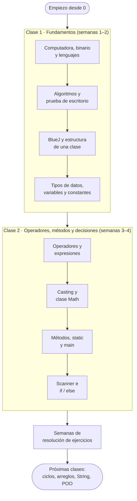

# Programación desde 0 · Java

> Curso de apoyo en **Java** para estudiantes de la **Universidad Mayor de San Simón (UMSS)**, pensado para acompañar **Introducción a la Programación (INF-135)** y las materias que la siguen.

> [!info] ¿Cómo está organizado el curso?
> - Cada **clase** tiene **2 semanas de teoría**. Después vienen las semanas de **resolución de ejercicios**.
> - Cada clase trae tres materiales: 📘 **apuntes** · 🖥️ **diapositivas** · ✍️ **práctica** (con autoevaluación al final).
> - Usamos **BlueJ** como entorno ([[Clase 01 - Apuntes#8. Preparar el entorno con BlueJ|cómo instalarlo]]).

---

## 🗺️ Ruta de aprendizaje



### Paso a paso

Marca cada paso cuando lo completes.

#### 🟦 Clase 1 · Del algoritmo a la primera clase en Java

| Semana | Temas | Materiales |
|---|---|---|
| **1** | Computadora y software · binario · lenguajes y compilación · algoritmos · elementos básicos (asignación, contador, acumulador, condicional, repetición) · prueba de escritorio | [[Clase 01 - Apuntes#Semana 1 · Pensar como computadora\|Apuntes §1–7]] |
| **2** | BlueJ · clase y objeto · estructura de una clase · tipos de datos · `char` y ASCII · `String` · variables · alcance · constantes | [[Clase 01 - Apuntes#Semana 2 · Tu primera clase en Java\|Apuntes §8–14]] |

- [ ] Leer los [[Clase 01 - Apuntes|apuntes de la Clase 1]]
- [ ] Repasar las [[Clase 01 - Diapositivas|diapositivas de la Clase 1]]
- [ ] Instalar BlueJ y crear el proyecto `Clase01`
- [ ] Resolver la [[Clase 01 - Práctica|práctica de la Clase 1]] (partes A, B, C y D)
- [ ] Completar la [[Clase 01 - Práctica#Autoevaluación|autoevaluación]]

#### 🟩 Clase 2 · Operadores, métodos y decisiones

| Semana | Temas | Materiales |
|---|---|---|
| **3** | Expresiones · aritméticos y división entera · módulo · asignación compuesta · `++` / `--` · relacionales · lógicos · precedencia · *casting* · `Math` · concatenación | [[Clase 02 - Apuntes#Semana 3 · Expresiones y operadores\|Apuntes §1–9]] |
| **4** | Métodos (retorno, parámetros, `void`) · métodos que usan métodos · `static` · `main` · `Scanner` · `if`, `if-else`, `else if`, anidados, ternario · prueba de escritorio con condiciones | [[Clase 02 - Apuntes#Semana 4 · Métodos, entrada de datos y decisiones\|Apuntes §10–15]] |

- [ ] Leer los [[Clase 02 - Apuntes|apuntes de la Clase 2]]
- [ ] Repasar las [[Clase 02 - Diapositivas|diapositivas de la Clase 2]]
- [ ] Resolver la [[Clase 02 - Práctica|práctica de la Clase 2]] (partes A a E)
- [ ] Intentar los [[Clase 02 - Práctica#Parte F · Problemas tipo examen ⭐⭐⭐|problemas tipo examen]]
- [ ] Completar la [[Clase 02 - Práctica#Autoevaluación|autoevaluación]]

#### 🟨 Semanas de resolución de ejercicios

- [ ] Terminar los ejercicios ⭐⭐⭐ de ambas prácticas
- [ ] Repasar las autoevaluaciones e identificar qué temas ya dominas

#### ⬜ Próximamente

| Clase | Tema |
|---|---|
| 3 | Ciclos: `while`, `do-while`, `for` |
| 4 | Métodos y subprogramas en profundidad |
| 5 | Arreglos |
| 6 | Matrices y recorridos |
| 7 | Cadenas (`String`) |
| 8 | Programación orientada a objetos |

---

## 📂 Mapa del vault

| Carpeta | Contenido |
|---|---|
| `01 Clase 1 - Fundamentos/` | [[Clase 01 - Apuntes]] · [[Clase 01 - Diapositivas]] · [[Clase 01 - Práctica]] |
| `02 Clase 2 - Operadores, métodos y decisiones/` | [[Clase 02 - Apuntes]] · [[Clase 02 - Diapositivas]] · [[Clase 02 - Práctica]] |
| `Recursos/` | [[Glosario]] |

### Todos los materiales (Dataview)

```dataview
TABLE tipo AS "Tipo", clase AS "Clase", semanas AS "Semanas"
FROM "01 Clase 1 - Fundamentos" OR "02 Clase 2 - Operadores, métodos y decisiones"
SORT clase ASC, tipo ASC
```

---

## 🧭 Cómo usar este vault

> [!tip] Recomendaciones para estudiar
> 1. **Antes de clase:** lee los apuntes del tema.
> 2. **En clase:** sigue las diapositivas y anota tus dudas.
> 3. **Después:** resuelve la práctica **en BlueJ**, no solo en papel.
> 4. **Siempre:** haz la **prueba de escritorio**; en los exámenes se califica.
> 5. ¿No entiendes un término? Búscalo en el [[Glosario]].

**Diapositivas:** abre una nota de diapositivas y usa el comando **"Iniciar presentación"** (plugin principal *Diapositivas*) o **Advanced Slides**. Cada `---` separa una diapositiva. El estilo mágico lo pone el fragmento CSS `magia-diapositivas` (Ajustes → Apariencia → Fragmentos CSS), que ya está activado.

**Prácticas:** los ejercicios tienen casillas `- [ ]` para marcar tu avance, y las pistas y respuestas están **plegadas**: ábrelas solo después de intentarlo.

