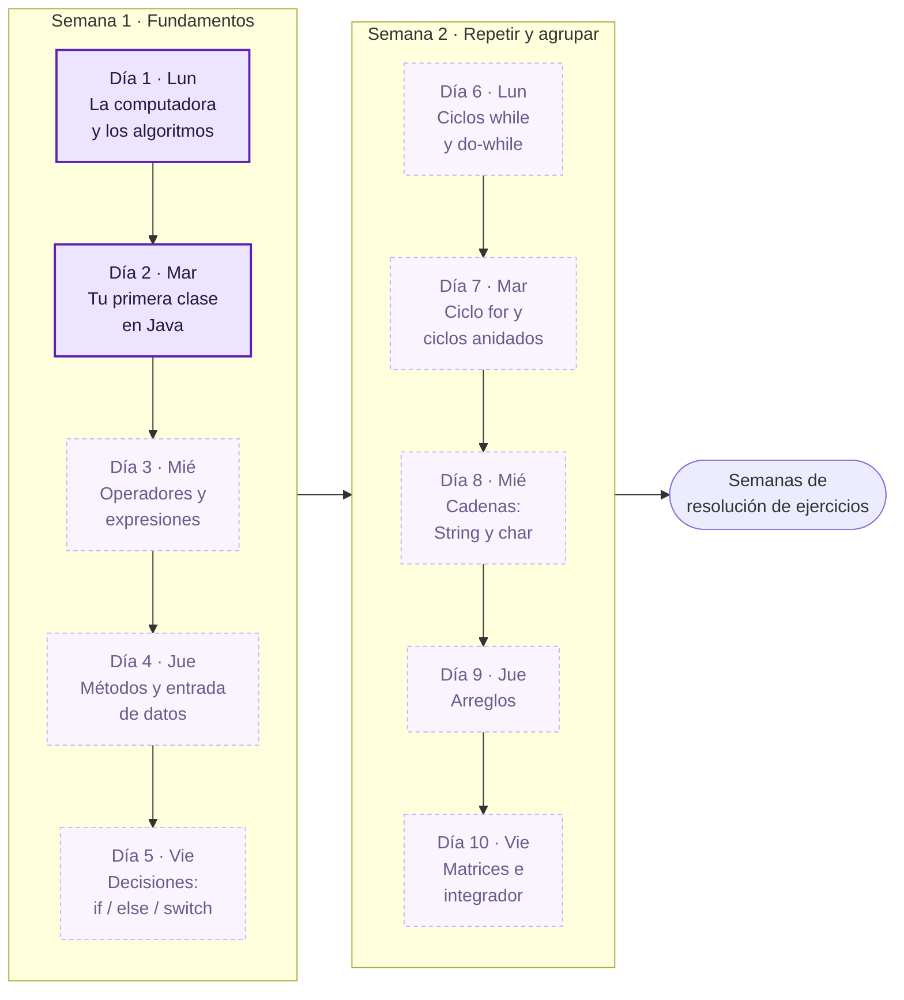

# Programación desde 0 · Java

> Curso de apoyo en **Java** para estudiantes de la **Universidad Mayor de San Simón (UMSS)**, pensado para acompañar **Introducción a la Programación (INF-135)** y las materias que la siguen.

> [!info] ¿Cómo está organizado el curso?
> - **2 semanas de teoría**, de **lunes a viernes**: 10 días de clase.
> - Después vienen las semanas de **resolución de ejercicios**.
> - Cada día trae tres materiales: 📘 **apuntes** · 🖥️ **diapositivas** · ✍️ **práctica** (con autoevaluación al final).
> - Usamos **BlueJ** como entorno ([[Día 02 - Apuntes#1. Preparar el entorno con BlueJ|cómo instalarlo]]).

---

## 🗺️ Ruta de aprendizaje



> [!note] Leyenda
> ✅ Los días con borde **sólido** ya tienen material · 🔜 los de borde **punteado** se publicarán más adelante.

---

## 📅 Semana 1 · Fundamentos

### ✅ Día 1 · Lunes · La computadora y los algoritmos

**Temas:** computadora (entrada, proceso, salida) · hardware y software · sistema binario · lenguajes de programación · compilador, bytecode y JVM · qué es un algoritmo y sus características · los datos en la memoria · elementos básicos (asignación, contador, acumulador, lectura, salida, condicional, repetición) · prueba de escritorio

- [ ] Leer los [[Día 01 - Apuntes|apuntes]]
- [ ] Repasar las [[Día 01 - Diapositivas|diapositivas]]
- [ ] Resolver la [[Día 01 - Práctica|práctica]] (en papel)
- [ ] Completar la [[Día 01 - Práctica#Autoevaluación|autoevaluación]]

### ✅ Día 2 · Martes · Tu primera clase en Java

**Temas:** instalar BlueJ · clase y objeto · estructura de una clase (atributos, constructor, métodos) · comentarios y palabras reservadas · compilar, crear objetos e inspeccionarlos · tipos de datos primitivos · `char` y ASCII · `String` · variables (declaración, inicialización, nombres) · alcance · constantes con `final`

- [ ] Instalar BlueJ y crear el proyecto `Dia02`
- [ ] Leer los [[Día 02 - Apuntes|apuntes]]
- [ ] Repasar las [[Día 02 - Diapositivas|diapositivas]]
- [ ] Resolver la [[Día 02 - Práctica|práctica]] (en BlueJ)
- [ ] Completar la [[Día 02 - Práctica#Autoevaluación|autoevaluación]]

### 🔜 Día 3 · Miércoles · Operadores y expresiones

**Temas:** expresiones · operadores aritméticos y la división entera · módulo `%` (pares, divisores, dígitos) · asignación compuesta · `++` y `--` · operadores relacionales · operadores lógicos y tablas de verdad · precedencia · conversión de tipos (*casting*) · la clase `Math` · concatenación con `+`

### 🔜 Día 4 · Jueves · Métodos y entrada de datos

**Temas:** estructura de un método · parámetros y argumentos · `return` y `void` · métodos que usan otros métodos · `static` · el método `main` · leer datos con `Scanner` · mostrar resultados con `print`, `println` y `printf` · separar la lógica de la entrada y salida

### 🔜 Día 5 · Viernes · Decisiones

**Temas:** `if` · `if-else` · `else if` · condicionales anidados · operador ternario · `switch` · comparar `String` con `.equals()` · prueba de escritorio con condiciones · errores clásicos con `if`

---

## 📅 Semana 2 · Repetir y agrupar

### 🔜 Día 6 · Lunes · Ciclos `while` y `do-while`

**Temas:** repetición controlada · `while` · `do-while` · contadores, acumuladores y banderas · validar datos de entrada · llevar a Java los algoritmos con repetición del Día 1 · ciclos infinitos y cómo evitarlos

### 🔜 Día 7 · Martes · Ciclo `for` y ciclos anidados

**Temas:** `for` · cuándo usar `for` o `while` · ciclos anidados · figuras con asteriscos (triángulos, pirámides) · trabajar con los dígitos de un número · series (Fibonacci, sumatorias)

### 🔜 Día 8 · Miércoles · Cadenas: `String` y `char`

**Temas:** métodos de `String` (`length`, `charAt`, `substring`, `indexOf`, `equals`, `toUpperCase`…) · recorrer una cadena carácter por carácter · contar vocales y palabras · palíndromos · cifrado César

### 🔜 Día 9 · Jueves · Arreglos

**Temas:** declarar y crear arreglos · recorrerlos · suma, promedio, máximo y mínimo · búsqueda secuencial · arreglos paralelos · arreglos como atributos de una clase · insertar y eliminar elementos

### 🔜 Día 10 · Viernes · Matrices e integrador

**Temas:** matrices · recorridos por filas, columnas y diagonales · sumas por fila y columna · clases que colaboran entre sí · problema integrador con todo lo visto

---

## 🧩 Después de las 2 semanas

- [ ] Resolver los ejercicios ⭐⭐⭐ de cada práctica
- [ ] Repasar las autoevaluaciones e identificar qué temas faltan reforzar
- [ ] Asistir a las sesiones de **resolución de ejercicios**

---

## 📂 Mapa del vault

| Carpeta | Contenido |
|---|---|
| `Semana 1/Día 01 - La computadora y los algoritmos/` | [[Día 01 - Apuntes]] · [[Día 01 - Diapositivas]] · [[Día 01 - Práctica]] |
| `Semana 1/Día 02 - Tu primera clase en Java/` | [[Día 02 - Apuntes]] · [[Día 02 - Diapositivas]] · [[Día 02 - Práctica]] |
| `Recursos/` | [[Glosario]] |

### Todos los materiales (Dataview)

```dataview
TABLE tipo AS "Tipo", dia AS "Día", semana AS "Semana"
FROM "Semana 1" OR "Semana 2"
SORT dia ASC, tipo ASC
```

---

## 🧭 Cómo usar este vault

> [!tip] Recomendaciones para estudiar
> 1. **Antes de clase:** lee los apuntes del día.
> 2. **En clase:** sigue las diapositivas y anota tus dudas.
> 3. **Después:** resuelve la práctica **ese mismo día**; cada día se apoya en el anterior.
> 4. **Siempre:** haz la **prueba de escritorio**; en los exámenes se califica.
> 5. ¿No entiendes un término? Búscalo en el [[Glosario]].

**Diapositivas:** abre una nota de diapositivas y usa el comando **"Iniciar presentación"** (plugin principal *Diapositivas*) o **Advanced Slides**. Cada `---` separa una diapositiva. El estilo mágico lo pone el fragmento CSS `magia-diapositivas` (Ajustes → Apariencia → Fragmentos CSS), que ya está activado.

**Prácticas:** los ejercicios tienen casillas `- [ ]` para marcar tu avance, y las pistas y respuestas están **plegadas**: ábrelas solo después de intentarlo.
