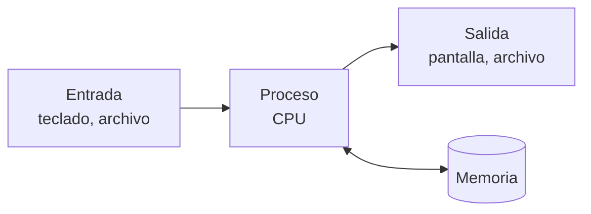
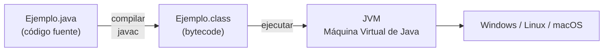

# Día 1 · La computadora y los algoritmos

> [!info] Datos de la clase
> **Semana 1 · Lunes** · **Materia de apoyo:** Introducción a la Programación (INF-135, UMSS)
> **Material del día:** [[Día 01 - Diapositivas|Diapositivas]] · [[Día 01 - Práctica|Práctica]] · [[README|Ruta de aprendizaje]]

> [!abstract] Al terminar este día podrás…
> - Explicar qué es una computadora, el hardware, el software y por qué trabaja en binario.
> - Explicar cómo un programa en Java pasa de código fuente a ejecutarse en la JVM.
> - Escribir un **algoritmo** con asignación, contador, acumulador, lectura, salida, condición y repetición.
> - Verificar un algoritmo con una **prueba de escritorio**.

---

### 1. La computadora y el software

Una **computadora** es una máquina que recibe datos (**entrada**), los transforma siguiendo instrucciones (**proceso**) y entrega resultados (**salida**). También puede **almacenar** datos para usarlos después.



| Concepto | Qué es | Ejemplos |
|---|---|---|
| **Hardware** | La parte física, lo que se puede tocar | CPU, memoria RAM, disco, teclado, monitor |
| **Software** | Las instrucciones (programas) que le dicen al hardware qué hacer | Sistema operativo, BlueJ, tus programas en Java |
| **CPU** | El "cerebro": ejecuta las instrucciones una por una | Intel, AMD, ARM |
| **Memoria RAM** | Donde viven los datos **mientras** el programa se ejecuta | Tus variables |

> [!note] Generaciones de computadoras (en una línea cada una)
> 1.ª tubos de vacío · 2.ª transistores · 3.ª circuitos integrados · 4.ª microprocesadores · 5.ª computación paralela, redes e inteligencia artificial.

### 2. ¿Por qué binario?

Los circuitos de una computadora solo distinguen dos estados: **hay corriente / no hay corriente**. Por eso toda información se guarda con dos dígitos, **0 y 1** (bits).

- **1 bit** = un 0 o un 1.
- **1 byte** = 8 bits → puede representar $2^8 = 256$ valores distintos.
- Con $n$ bits se representan $2^n$ valores.

**Ejemplo: convertir 26 a binario** (dividir entre 2 y leer los residuos de abajo hacia arriba):

| División | Cociente | Residuo |
|---|---|---|
| 26 ÷ 2 | 13 | **0** |
| 13 ÷ 2 | 6 | **1** |
| 6 ÷ 2 | 3 | **0** |
| 3 ÷ 2 | 1 | **1** |
| 1 ÷ 2 | 0 | **1** |

$26_{10} = 11010_2$. Comprobación: $16 + 8 + 0 + 2 + 0 = 26$.

> [!tip] Esto vuelve a aparecer en Java
> Mañana, en el **Día 2**, verás que los rangos de los tipos de datos (`byte`, `int`, `long`…) dependen de **cuántos bits** usan. Y Java permite escribir `0b11010` para el 26 en binario.

### 3. Lenguajes de programación

| Nivel | Cómo se ve | Quién lo entiende |
|---|---|---|
| **Lenguaje máquina** | `10110000 01100001` | La CPU directamente |
| **Ensamblador** | `MOV AL, 61h` | Casi la CPU (traducción 1 a 1) |
| **Alto nivel** | `int edad = 20;` | Personas → necesita traducción |

Java es un lenguaje de **alto nivel**. El camino de tu código hasta ejecutarse es:



> [!important] La idea clave de Java
> El compilador no produce código para un sistema operativo concreto sino **bytecode**, que ejecuta la **JVM**. Por eso un mismo programa funciona en cualquier sistema operativo: *"escribe una vez, ejecuta en cualquier lugar"*.

- **Compilar** = revisar que el código esté **bien escrito** (sintaxis) y traducirlo.
- Que compile **no** garantiza que funcione bien: puede tener **errores de lógica**.

### 4. ¿Qué es un algoritmo?

Un **algoritmo** es una secuencia **finita** y **ordenada** de pasos que resuelve un problema. Es como una receta de cocina: pasos numerados, en orden, que terminan.

**Características de un buen algoritmo**

| Característica | Significa |
|---|---|
| **Finitud** | Termina después de un número finito (y razonable) de pasos |
| **Correctitud** | Resuelve el problema y cumple lo que se pide |
| **Robustez** | Contempla todos los casos, sin que se escape ningún detalle |
| **Completitud** | Tiene todo lo necesario para llegar a la solución |
| **Eficiencia** | Usa la menor cantidad de recursos (pasos, memoria) |
| **Eficacia** | Alcanza el objetivo |

**Pasos para resolver un problema**

1. **Análisis**: ¿qué datos tengo (entrada)? ¿qué debo obtener (salida)? ¿qué relación hay entre ellos?
2. **Diseño**: escribir el algoritmo.
3. **Prueba de escritorio**: simularlo a mano.
4. **Codificación**: traducirlo a Java.
5. **Prueba**: ejecutarlo con varios datos.

### 5. Los datos en la memoria

Imagina la memoria como un **casillero**: cada casilla tiene una **dirección** y un **contenido**. Para no trabajar con direcciones en binario, les ponemos **nombres**: las **variables**.

| Variable | Contenido |
|---|---|
| `S` | 100 |
| `C` | −1 |
| `P` | *basura* |
| `SUMA` | *basura* |

> [!warning] La memoria no empieza limpia
> Una casilla que no inicializaste tiene **basura**: restos de un trabajo anterior. Por eso siempre damos un **valor inicial** a las variables antes de usarlas.

### 6. Elementos básicos de un algoritmo

Usaremos la notación del pseudocódigo de la materia: `←` (o `<=`) significa **asignar**.

| Elemento | Notación | Qué hace |
|---|---|---|
| **Asignación directa** | `Z ← 7` | Guarda 7 en Z (el valor anterior se pierde) |
| **Asignación diferida** | `Z ← Z + 3` | Primero calcula la derecha, **después** guarda en la izquierda |
| **Contador** | `C ← 0` (una vez) · `C ← C + 1` (cada vez) | Cuenta de 1 en 1 |
| **Acumulador** | `S ← 0` (una vez) · `S ← S + X` (cada vez) | Va sumando valores |
| **Lectura** | `Leer X` | Pide un dato al usuario |
| **Salida** | `Mostrar "La suma es: ", S` | Muestra mensajes y resultados |
| **Condicional** | `Si A > B Entonces M ← A Sino M ← B` | Decide entre dos caminos |
| **Repetición** | `Si C < 10 Entonces Ir a 3` | Vuelve a un paso anterior |

> [!example] Ejemplo 1 · Suma de los números del 1 al 10
> ```text
> 1. C ← 0
> 2. S ← 0
> 3. C ← C + 1
> 4. S ← S + C
> 5. Si C < 10 Entonces Ir a 3
> 6. Mostrar "La suma es: ", S
> 7. FIN
> ```
> - `C` es un **contador**: genera 1, 2, 3, …, 10.
> - `S` es un **acumulador**: va sumando lo que genera `C`.
> - Los pasos 1 y 2 están **fuera** de la repetición: se ejecutan una sola vez.

> [!example] Ejemplo 2 · Factorial de X
> ```text
> 1. Leer X
> 2. F ← 1 : C ← 0
> 3. C ← C + 1 : F ← F * C
> 4. Si C < X Entonces Ir a 3
> 5. Mostrar "El factorial es: ", F
> 6. FIN
> ```
> ¿Por qué `F` empieza en **1** y no en 0? Porque si empezara en 0, `F * C` daría siempre 0.

### 7. Prueba de escritorio

Es **simular a mano** lo que haría la computadora: una tabla con una columna por variable, donde anotas cada valor nuevo paso a paso. Es **la etapa más importante**, porque te permite descubrir:

- pasos en el orden incorrecto,
- algo que falta o que sobra,
- repeticiones que se ejecutan una vez de más o de menos.

**Prueba de escritorio del Ejemplo 1** (solo las primeras vueltas):

| Paso | C | S | ¿C < 10? |
|---|---|---|---|
| 1–2 | 0 | 0 | |
| 3–4 | 1 | 1 | sí → ir a 3 |
| 3–4 | 2 | 3 | sí → ir a 3 |
| 3–4 | 3 | 6 | sí → ir a 3 |
| … | … | … | … |
| 3–4 | 10 | 55 | **no** → paso 6 |

Salida: `La suma es: 55` ✔️

> [!tip] ¿Con qué datos probar?
> 1. Primero, con datos **fáciles** para ver que funciona.
> 2. Después, busca datos que lo hagan **fallar** (cero, negativos, el límite exacto).
> 3. Si hay varios casos posibles, prueba **uno por cada caso**. Por ejemplo, para "APROBADO si nota ≥ 51, REPROBADO si nota < 50, CASO ESPECIAL entre 50 y 51" prueba con 70, 40 y 50.5.

---

## Resumen

> [!summary] Lo esencial del Día 1
> - Una computadora procesa **entrada → proceso → salida** y trabaja en **binario**.
> - Java se compila a **bytecode** y se ejecuta en la **JVM**.
> - Un **algoritmo** es finito y ordenado. Se construye con asignación, contador, acumulador, lectura, salida, condicional y repetición.
> - La **prueba de escritorio** es una tabla con los valores de las variables, paso a paso.

## Siguiente paso

- ✍️ Practica: [[Día 01 - Práctica]]
- 📖 Glosario: [[Glosario]]
- ➡️ Mañana: [[Día 02 - Apuntes|Día 2 · Tu primera clase en Java]]
