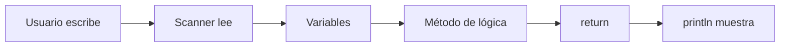

# Día 4 · Métodos y entrada de datos

> [!info] Datos de la clase
> **Semana 1 · Jueves** · **IDE:** BlueJ · **Requisito:** [[Día 03 - Apuntes|Día 3]]
> **Material del día:** [[Día 04 - Diapositivas|Diapositivas]] · [[Día 04 - Práctica|Práctica]] · [[README|Ruta de aprendizaje]]

> [!abstract] Al terminar este día podrás…
> - Escribir **métodos** con parámetros y valor de retorno, y entender `void`.
> - Dividir un problema en métodos que **se llaman entre sí**.
> - Explicar qué significa `static` y por qué `main` lo necesita.
> - Leer datos del teclado con **`Scanner`** y mostrar resultados con `println` y `printf`.
> - Separar la **lógica** (métodos que devuelven) de la **entrada y salida** (`main`).

---

### 1. Estructura de un método

Un **método** describe **cómo** un objeto realiza una acción.

```java
public   int      sumar   (int a, int b) {
//  ↑     ↑         ↑          ↑
// acceso retorno  nombre   parámetros
    int suma = a + b;
    return suma;          // devuelve el resultado
}
```

| Parte | Qué indica |
|---|---|
| **Modificador de acceso** | Quién puede usar el método: `public` (cualquiera), `private` (solo la misma clase) |
| **Tipo de retorno** | Qué tipo de valor devuelve: `int`, `double`, `boolean`, `String`… o **`void`** si no devuelve nada |
| **Nombre** | Un verbo en `camelCase`: `sumar`, `calcularPromedio`, `esPar` |
| **Parámetros** | Los datos que necesita desde afuera (pueden ser cero) |
| **Cuerpo** | Las instrucciones entre `{ }` |
| **`return`** | Termina el método y entrega el valor. Obligatorio si el tipo no es `void` |

> [!example] Las formas más comunes
> ```java
> // Recibe datos y devuelve un resultado
> public double promedio(double n1, double n2) {
>     return (n1 + n2) / 2;
> }
>
> // Pregunta: devuelve boolean (nombre con "es…" o "tiene…")
> public boolean esPar(int n) {
>     return n % 2 == 0;
> }
>
> // No devuelve nada: cambia el estado del objeto
> public void reiniciar() {
>     contador = 0;
> }
> ```

**Parámetro vs. argumento:** el **parámetro** es la variable de la declaración (`int a`); el **argumento** es el valor concreto que pasas al llamar (`sumar(8, 8)`).

### 2. Métodos que usan otros métodos

Un método puede **reutilizar** a otro. Así se divide un problema grande en partes pequeñas:

```java
public double promedioTres(double a, double b, double c) {
    return (a + b + c) / 3;
}

public boolean aprobo(double a, double b, double c) {
    double p = promedioTres(a, b, c);   // ← reutiliza
    return p >= 51;
}
```

> [!important] Devolver vs. mostrar
> Los métodos que resuelven el problema deben **devolver** (`return`) su resultado, **no** imprimirlo. Así ese resultado se puede usar en otras partes. La impresión se hace al final, en `main`.

### 3. static, de la clase y no del objeto

- Un método **sin** `static` pertenece a **cada objeto**: para usarlo, primero creas un objeto (`new`).
- Un método **con** `static` pertenece a **la clase**: se llama directamente (como `Math.sqrt(9)`).

> [!warning] Error común
> *non-static method sumar(int,int) cannot be referenced from a static context*
> Un método `static` (como `main`) **no puede** llamar directamente a un método de objeto. Soluciones: crear un objeto y llamar con `objeto.sumar(…)`, o declarar el método también `static`.

### 4. El método main y la entrada de datos con Scanner

`main` es el **punto de entrada** de un programa Java. En BlueJ puedes probar sin él (clic derecho sobre el objeto), pero en cualquier otro IDE lo necesitas.

```java
import java.util.Scanner;              // 1) importar la clase

public class Calculadora {

    public int sumar(int a, int b) {   // la LÓGICA: devuelve
        return a + b;
    }

    public static void main(String[] args) {
        Scanner sc = new Scanner(System.in);     // 2) crear el lector
        System.out.print("Primer número: ");
        int n1 = sc.nextInt();                   // 3) leer
        System.out.print("Segundo número: ");
        int n2 = sc.nextInt();

        Calculadora calc = new Calculadora();    // 4) crear el objeto
        int resultado = calc.sumar(n1, n2);      // 5) usar la lógica

        System.out.println("La suma es: " + resultado); // 6) mostrar
    }
}
```



**Métodos de `Scanner`**

| Método | Lee |
|---|---|
| `nextInt()` | un `int` |
| `nextDouble()` | un `double` |
| `nextLong()` | un `long` |
| `nextBoolean()` | `true` / `false` |
| `next()` | una palabra (hasta el espacio) |
| `nextLine()` | una línea completa |
| `next().charAt(0)` | un `char` |

**Mostrar resultados**

| Instrucción | Hace |
|---|---|
| `System.out.println(x)` | muestra `x` y **salta** de línea |
| `System.out.print(x)` | muestra `x` **sin** saltar de línea |
| `System.out.printf("%.2f%n", x)` | muestra `x` con 2 decimales |

> [!warning] Dos problemas típicos con `Scanner`
> 1. **Decimales con coma o punto.** `nextDouble()` usa la configuración regional de tu computadora: en algunas debes escribir `4,5` en lugar de `4.5`. Para aceptar siempre el punto:
>    `sc.useLocale(java.util.Locale.US);`
> 2. **`nextLine()` después de `nextInt()`** devuelve una línea vacía, porque `nextInt()` deja el "Enter" en el buffer. Solución: agrega un `sc.nextLine();` extra antes de leer la línea.

> [!note] ¿Y `String[] args`?
> Es un **arreglo** de textos que se puede pasar al ejecutar el programa desde la terminal. Por ahora tómalo como parte de la "fórmula" de `main`; los arreglos se ven más adelante en la materia.

### 5. El patrón que usaremos en todo el curso

```java
import java.util.Scanner;

public class Conversor {

    // LÓGICA: recibe datos y DEVUELVE el resultado
    public double celsiusAFahrenheit(double c) {
        return c * 9 / 5 + 32;
    }

    // ENTRADA Y SALIDA: lee, llama a la lógica y muestra
    public static void main(String[] args) {
        Scanner sc = new Scanner(System.in);
        sc.useLocale(java.util.Locale.US);
        System.out.print("Temperatura en °C: ");
        double c = sc.nextDouble();

        Conversor conv = new Conversor();
        double f = conv.celsiusAFahrenheit(c);
        System.out.printf("%.1f °C = %.1f °F%n", c, f);
    }
}
```

| Pseudocódigo (Día 1) | Java |
|---|---|
| `Leer X` | `x = sc.nextInt();` |
| `Mostrar "La suma es: ", S` | `System.out.println("La suma es: " + s);` |
| Un "subproblema" del algoritmo | Un **método** que devuelve su resultado |

> [!tip] Probar en BlueJ y con `main`
> Sigue probando cada método con clic derecho sobre un objeto, como el [[Día 02 - Apuntes#4. Probar en BlueJ objetos e inspector|Día 2]]. Cuando todos funcionen, escribe el `main` que los usa.

---

## Resumen

> [!summary] Lo esencial del Día 4
> - Un método = acceso + tipo de retorno + nombre + parámetros + cuerpo. `void` no devuelve nada.
> - Parámetro: la variable de la declaración. Argumento: el valor que se pasa al llamar.
> - `static` es de la clase; `main` es `static` y debe crear un objeto para usar los demás métodos.
> - `Scanner`: `nextInt`, `nextDouble`, `next`, `nextLine`. Cuidado con la coma decimal y con `nextLine` después de `nextInt`.
> - La lógica **devuelve**; solo `main` **lee e imprime**.

## Siguiente paso

- ✍️ Practica: [[Día 04 - Práctica]]
- 📖 Glosario: [[Glosario]]
- ⬅️ Ayer: [[Día 03 - Apuntes|Día 3 · Operadores y expresiones]]
- ➡️ Mañana: [[Día 05 - Apuntes|Día 5 · Decisiones]]
