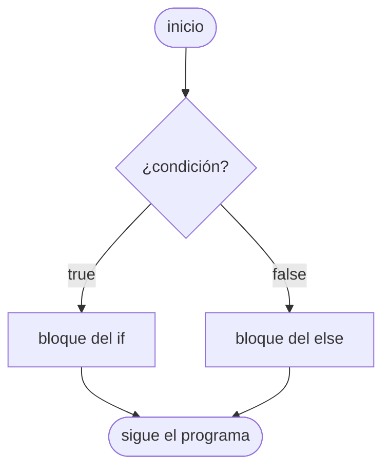

# Día 5 · Decisiones

> [!info] Datos de la clase
> **Semana 1 · Viernes** · **IDE:** BlueJ · **Requisito:** [[Día 04 - Apuntes|Día 4]]
> **Material del día:** [[Día 05 - Diapositivas|Diapositivas]] · [[Día 05 - Práctica|Práctica]] · [[README|Ruta de aprendizaje]]

> [!abstract] Al terminar este día podrás…
> - Tomar decisiones con **`if`, `if-else` y `else if`**.
> - Escribir condicionales **anidados** y usar el operador **ternario**.
> - Elegir entre valores concretos con **`switch`**.
> - Elegir datos de prueba para **cada camino** de un condicional.
> - Reconocer y evitar los errores clásicos con `if`.

---

### 1. La sentencia if

La sentencia `if` permite que el programa **elija** qué hacer según una **condición** (una expresión `boolean`).



### 2. `if` solo

Se ejecuta **solo si** la condición es verdadera; si es falsa, no pasa nada.

```java
public double precioConDescuento(double precio) {
    double res = precio;
    if (precio > 100) {
        res = precio * 0.9;     // 10 % de descuento
    }
    return res;
}
```

### 3. `if-else`

Uno de los dos bloques se ejecuta **siempre**, nunca ambos. El `else` **no** lleva condición y **no** puede existir sin su `if`.

```java
public String evaluarNota(double nota) {
    String res;
    if (nota >= 51) {
        res = "APROBADO";
    } else {
        res = "REPROBADO";
    }
    return res;
}
```

### 4. `else if` para varios caminos

Se revisan las condiciones **en orden**; se ejecuta la **primera** que sea verdadera.

```java
public String clasificar(double nota) {
    String res;
    if (nota < 0 || nota > 100) {
        res = "NOTA INVÁLIDA";
    } else if (nota >= 51) {
        res = "APROBADO";
    } else if (nota >= 50) {
        res = "CASO ESPECIAL";
    } else {
        res = "REPROBADO";
    }
    return res;
}
```

### 5. `if` anidados

Un `if` dentro de otro. Útil cuando una pregunta solo tiene sentido si otra ya se cumplió.

```java
public String retirar(double saldo, double monto) {
    String res;
    if (monto > 0) {
        if (monto <= saldo) {
            res = "Retiro exitoso";
        } else {
            res = "Saldo insuficiente";
        }
    } else {
        res = "Monto inválido";
    }
    return res;
}
```

### 6. El operador ternario

Es un `if-else` corto que **devuelve un valor**: `condición ? valorSiTrue : valorSiFalse`.

```java
String estado = nota >= 51 ? "APROBADO" : "REPROBADO";
int mayor = a > b ? a : b;
```

### 7. `switch`: elegir entre valores concretos

Cuando comparas **una misma variable** con varios valores **exactos**, `switch` es más claro que una cadena de `else if`.

```java
public String nombreDia(int dia) {
    String nombre;
    switch (dia) {
        case 1: nombre = "Lunes"; break;
        case 2: nombre = "Martes"; break;
        case 3: nombre = "Miércoles"; break;
        case 4: nombre = "Jueves"; break;
        case 5: nombre = "Viernes"; break;
        case 6:
        case 7: nombre = "Fin de semana"; break;
        default: nombre = "Día inválido";
    }
    return nombre;
}
```

| Parte | Qué hace |
|---|---|
| `switch (dia)` | La variable que se compara. Puede ser `int`, `char` o `String` |
| `case 1:` | Si `dia == 1`, empieza a ejecutar aquí |
| `break;` | Sale del `switch`. **Sin** `break`, sigue ejecutando el siguiente `case` |
| `default:` | Se ejecuta si ningún `case` coincide (como el `else` final) |

> [!warning] El `break` olvidado
> Si olvidas un `break`, la ejecución "se cae" al siguiente `case`. A veces se hace a propósito (como `case 6:` y `case 7:` arriba), pero casi siempre es un error.

> [!tip] ¿`switch` o `if`?
> - Valores **exactos** de una variable (`1`, `'a'`, `"suma"`) → `switch`.
> - **Rangos** o condiciones compuestas (`nota >= 51`, `x > 0 && y > 0`) → `if / else if`. `switch` no puede comparar rangos.

> [!example] Calculadora con `switch` sobre un `char`
> ```java
> public double operar(double a, char op, double b) {
>     double r;
>     switch (op) {
>         case '+': r = a + b; break;
>         case '-': r = a - b; break;
>         case '*': r = a * b; break;
>         case '/': r = a / b; break;
>         default:  r = 0;
>     }
>     return r;
> }
> ```

### 8. Errores clásicos con `if`

> [!danger] Tres errores clásicos con `if`
> ```java
> if (nota >= 51);              // ✘ el ";" termina el if: el bloque se ejecuta SIEMPRE
> { res = "APROBADO"; }
>
> if (nota >= 51)               // ✘ sin llaves, solo la PRIMERA línea pertenece al if
>     res = "APROBADO";
>     contador++;               //    esta línea se ejecuta siempre
>
> if (nombre == "Ana") { … }    // ✘ los String se comparan con .equals()
> ```
> **Usa siempre llaves**, aunque el bloque tenga una sola línea.

### 9. Prueba de escritorio con condicionales

La prueba de escritorio también sirve con código Java. Para un `if`, elige **un dato por cada camino** y uno en cada **límite**:

| `nota` | `nota < 0 \|\| nota > 100` | `nota >= 51` | `nota >= 50` | Resultado |
|---|---|---|---|---|
| 75 | false | **true** | — | APROBADO |
| 51 | false | **true** | — | APROBADO (límite) |
| 50.5 | false | false | **true** | CASO ESPECIAL |
| 30 | false | false | false | REPROBADO |
| 120 | **true** | — | — | NOTA INVÁLIDA |

### 10. Ejemplo integrador

> [!example] El mayor de tres números
> ```java
> import java.util.Scanner;
>
> public class Mayor {
>
>     public int mayorDeDos(int a, int b) {
>         return a > b ? a : b;
>     }
>
>     public int mayorDeTres(int a, int b, int c) {
>         return mayorDeDos(mayorDeDos(a, b), c);
>     }
>
>     public static void main(String[] args) {
>         Scanner sc = new Scanner(System.in);
>         System.out.print("Tres números: ");
>         int a = sc.nextInt();
>         int b = sc.nextInt();
>         int c = sc.nextInt();
>
>         Mayor m = new Mayor();
>         System.out.println("El mayor es " + m.mayorDeTres(a, b, c));
>     }
> }
> ```
> Fíjate en el patrón que usaremos en todo el curso: **la lógica en métodos que devuelven** y **`main` solo lee, llama y muestra**.


---

## Resumen

> [!summary] Lo esencial del Día 5
> - `if` solo: se ejecuta si la condición es `true`. `if-else`: siempre uno de los dos, nunca ambos.
> - `else if`: se ejecuta la **primera** condición verdadera.
> - Ternario: `condición ? valorSiTrue : valorSiFalse`.
> - `switch` compara una variable con valores exactos; no olvides `break` ni `default`.
> - Siempre con **llaves**, sin `;` después del `if`, y `String` con `.equals()`.
> - Prueba de escritorio: un dato por cada camino y uno en cada límite.

## Siguiente paso

- ✍️ Practica: [[Día 05 - Práctica]]
- 📖 Glosario: [[Glosario]]
- ⬅️ Ayer: [[Día 04 - Apuntes|Día 4 · Métodos y entrada de datos]]
- ➡️ Mañana: el lunes, **Día 6 · Ciclos `while` y `do-while`** ([[Día 06 - Apuntes|apuntes]])
