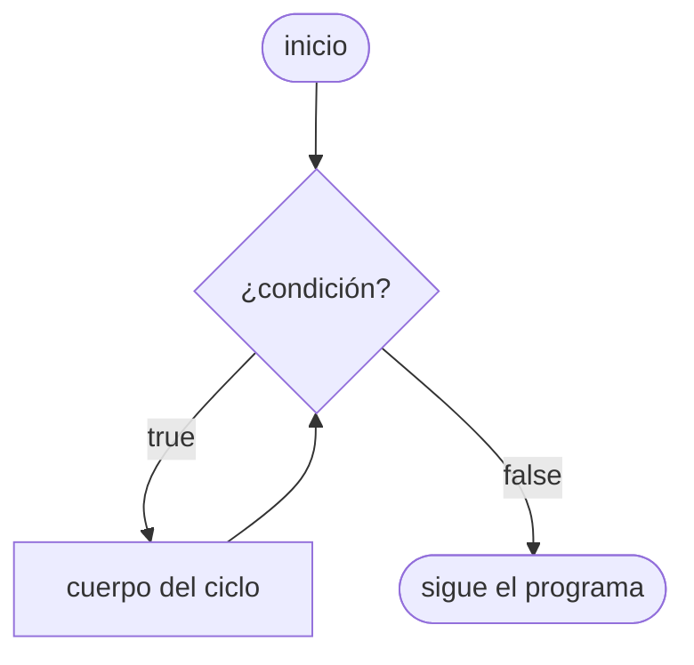
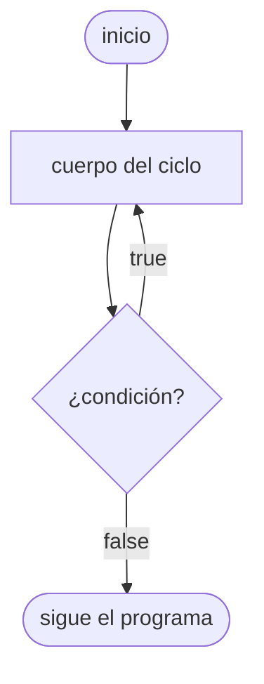

# Día 6 · Ciclos `while` y `do-while`

> [!info] Datos de la clase
> **Semana 2 · Lunes** · **IDE:** BlueJ · **Requisito:** [[Día 05 - Apuntes|Día 5]]
> **Material del día:** [[Día 06 - Diapositivas|Diapositivas]] · [[Día 06 - Práctica|Práctica]] · [[README|Ruta de aprendizaje]]

> [!abstract] Al terminar este día podrás…
> - Repetir instrucciones con **`while`** y **`do-while`**.
> - Identificar las tres partes de todo ciclo: **inicialización, condición y actualización**.
> - Usar **contadores, acumuladores, centinelas y banderas** dentro de un ciclo.
> - Recorrer los **dígitos** de un número.
> - Pasar a Java los algoritmos con repetición del [[Día 01 - Apuntes|Día 1]] y verificarlos con la **prueba de escritorio**.

---

### 1. ¿Por qué repetir?

El [[Día 01 - Apuntes#6. Elementos básicos de un algoritmo|Día 1]] escribimos la suma del 1 al 10 así:

```text
1. C ← 0
2. S ← 0
3. C ← C + 1
4. S ← S + C
5. Si C < 10 Entonces Ir a 3
6. Mostrar "La suma es: ", S
```

El paso 5 **vuelve atrás** mientras se cumple una condición. En Java no existe "Ir a": para repetir usamos **ciclos** (también llamados *bucles* o *estructuras repetitivas*).

### 2. El ciclo `while`

`while` significa **"mientras"**: repite un bloque **mientras** la condición sea verdadera.

```java
while (condición) {
    // cuerpo: se repite mientras la condición sea true
}
```



> [!example] La suma del 1 al 10, ahora en Java
> ```java
> public int sumaHasta10() {
>     int c = 0;          // inicialización
>     int s = 0;
>     while (c < 10) {    // condición
>         c = c + 1;      // actualización
>         s = s + c;
>     }
>     return s;           // 55
> }
> ```
> Compara línea por línea con el pseudocódigo: es **el mismo algoritmo**.

> [!important] La condición se revisa **antes** de cada vuelta
> Si al principio la condición ya es `false`, el cuerpo **no se ejecuta ni una vez**.

### 3. Las tres partes de todo ciclo

| Parte | Pregunta | En el ejemplo |
|---|---|---|
| **Inicialización** | ¿Con qué valores empiezan las variables? | `c = 0`, `s = 0` |
| **Condición** | ¿Hasta cuándo se repite? | `c < 10` |
| **Actualización** | ¿Qué cambia en cada vuelta para que algún día termine? | `c = c + 1` |

> [!danger] Ciclo infinito
> Si la actualización **nunca** hace falsa la condición, el ciclo no termina:
> ```java
> int i = 1;
> while (i <= 10) {
>     System.out.println(i);
>     // ✘ falta i++ → imprime 1 para siempre
> }
> ```
> En BlueJ, si tu programa se "cuelga", detén la máquina virtual con clic derecho en la barra de progreso → **Reset Java Virtual Machine** (o `Ctrl+Shift+R`).

### 4. Prueba de escritorio de un ciclo

Se hace igual que el Día 1: una columna por variable y una fila por vuelta.

```java
int n = 5, f = 1, i = 1;
while (i <= n) {
    f = f * i;
    i++;
}
```

| Vuelta | `i` (antes) | ¿`i <= n`? | `f` | `i` (después) |
|---|---|---|---|---|
| 1 | 1 | sí | 1 | 2 |
| 2 | 2 | sí | 2 | 3 |
| 3 | 3 | sí | 6 | 4 |
| 4 | 4 | sí | 24 | 5 |
| 5 | 5 | sí | 120 | 6 |
| — | 6 | **no** | sale con `f = 120` | |

> [!tip] Revisa siempre la primera y la última vuelta
> El error más común es que el ciclo se ejecute **una vez de más o de menos** (`<` en lugar de `<=`, o al revés).

### 5. Contadores y acumuladores en Java

| Patrón | Antes del ciclo | Dentro del ciclo |
|---|---|---|
| **Contador** | `int cont = 0;` | `cont++;` |
| **Acumulador (suma)** | `int suma = 0;` | `suma += x;` |
| **Acumulador (producto)** | `long prod = 1;` | `prod *= x;` |
| **Mayor** | `int mayor = primerValor;` | `if (x > mayor) mayor = x;` |

> [!example] Promedio de los números pares entre 1 y `n`
> ```java
> public double promedioPares(int n) {
>     int suma = 0, cant = 0;
>     int i = 2;
>     while (i <= n) {
>         suma += i;
>         cant++;
>         i += 2;
>     }
>     return cant > 0 ? (double) suma / cant : 0;
> }
> ```

### 6. Ciclos controlados por centinela

A veces **no sabemos cuántas veces** se repetirá. Un **centinela** es un valor especial que indica "ya terminé" (por ejemplo, `0` o `-1`).

```java
Scanner sc = new Scanner(System.in);
int suma = 0, cant = 0;
System.out.print("Número (0 para terminar): ");
int x = sc.nextInt();
while (x != 0) {          // el centinela es 0
    suma += x;
    cant++;
    System.out.print("Número (0 para terminar): ");
    x = sc.nextInt();     // leer el siguiente ANTES de volver a preguntar
}
System.out.println("Leíste " + cant + " números. Suma: " + suma);
```

> [!warning] Lectura previa
> Fíjate que se lee **una vez antes** del ciclo y **otra vez al final** del cuerpo. Así el centinela nunca se suma.

### 7. Banderas (`boolean`)

Una **bandera** es una variable `boolean` que recuerda si **algo pasó** durante el ciclo.

> [!example] ¿Es primo?
> ```java
> public boolean esPrimo(int n) {
>     boolean primo = n > 1;       // bandera
>     int d = 2;
>     while (d * d <= n && primo) {
>         if (n % d == 0) {
>             primo = false;       // encontramos un divisor
>         }
>         d++;
>     }
>     return primo;
> }
> ```
> Basta probar divisores hasta $\sqrt{n}$ (por eso `d * d <= n`), y el ciclo se detiene apenas la bandera cambia.

### 8. El ciclo `do-while`

`do-while` ejecuta el cuerpo **primero** y pregunta **después**. Por eso se ejecuta **al menos una vez**.

```java
do {
    // cuerpo
} while (condición);   // ← lleva punto y coma
```



| | `while` | `do-while` |
|---|---|---|
| ¿Cuándo revisa la condición? | **Antes** de cada vuelta | **Después** de cada vuelta |
| Vueltas mínimas | 0 | **1** |
| Uso típico | Repetir mientras algo sea cierto | **Validar datos** y **menús** |

> [!example] Validar una entrada
> ```java
> int nota;
> do {
>     System.out.print("Nota (0-100): ");
>     nota = sc.nextInt();
> } while (nota < 0 || nota > 100);   // repite mientras sea inválida
> ```

> [!example] Un menú que se repite
> ```java
> int op;
> do {
>     System.out.println("1. Depositar  2. Retirar  3. Ver saldo  0. Salir");
>     op = sc.nextInt();
>     switch (op) {
>         case 1: /* … */ break;
>         case 2: /* … */ break;
>         case 3: /* … */ break;
>         case 0: System.out.println("¡Adiós!"); break;
>         default: System.out.println("Opción inválida");
>     }
> } while (op != 0);
> ```

### 9. Recorrer los dígitos de un número

Con `% 10` sacas el último dígito y con `/ 10` lo quitas ([[Día 03 - Apuntes#2. Operadores aritméticos|Día 3]]). Repitiéndolo **mientras queden dígitos** (`n > 0`) recorres todo el número, sin importar cuántas cifras tenga.

```java
public int contarDigitos(int n) {
    int cont = 0;
    do {                 // do-while: el 0 también tiene 1 dígito
        n = n / 10;
        cont++;
    } while (n > 0);
    return cont;
}

public int sumarDigitos(int n) {
    int suma = 0;
    while (n > 0) {
        suma += n % 10;
        n = n / 10;
    }
    return suma;
}

public int invertir(int n) {
    int inv = 0;
    while (n > 0) {
        inv = inv * 10 + n % 10;
        n = n / 10;
    }
    return inv;
}
```

**Prueba de escritorio de `invertir(123)`:**

| Vuelta | `n % 10` | `inv` | `n` |
|---|---|---|---|
| inicio | | 0 | 123 |
| 1 | 3 | 3 | 12 |
| 2 | 2 | 32 | 1 |
| 3 | 1 | 321 | 0 → sale |

> [!tip] Número espejo (palíndromo)
> Un número es espejo si es igual a su inverso: <code>n &#61;&#61; invertir(n)</code>.

### 10. Errores comunes con ciclos

> [!danger] Revisa estos cuatro antes de pedir ayuda
> ```java
> while (i < 10);        // ✘ el ";" crea un ciclo vacío (¡e infinito!)
> { i++; }
>
> int suma;              // ✘ acumulador sin inicializar
> while (i <= n) { suma += i; i++; }
>
> while (i <= n) {       // ✘ inicializar DENTRO del ciclo lo reinicia cada vuelta
>     int suma = 0;
>     suma += i; i++;
> }
>
> } while (x > 0)        // ✘ al do-while le falta el ";"
> ```

---

## Resumen

> [!summary] Lo esencial del Día 6
> - `while (condición) { … }` repite **mientras** la condición sea `true`; puede ejecutarse 0 veces.
> - `do { … } while (condición);` se ejecuta **al menos una vez**: ideal para validar datos y menús.
> - Todo ciclo tiene **inicialización, condición y actualización**. Sin actualización hay ciclo infinito.
> - Contador `cont++`, acumulador `suma += x`, centinela para terminar, bandera `boolean` para recordar.
> - Dígitos: `n % 10` saca el último, `n / 10` lo quita, `while (n > 0)` los recorre todos.

## Siguiente paso

- ✍️ Practica: [[Día 06 - Práctica]]
- 📖 Glosario: [[Glosario]]
- ⬅️ El viernes: [[Día 05 - Apuntes|Día 5 · Decisiones]]
- ➡️ Mañana: [[Día 07 - Apuntes|Día 7 · Ciclo for y ciclos anidados]]
