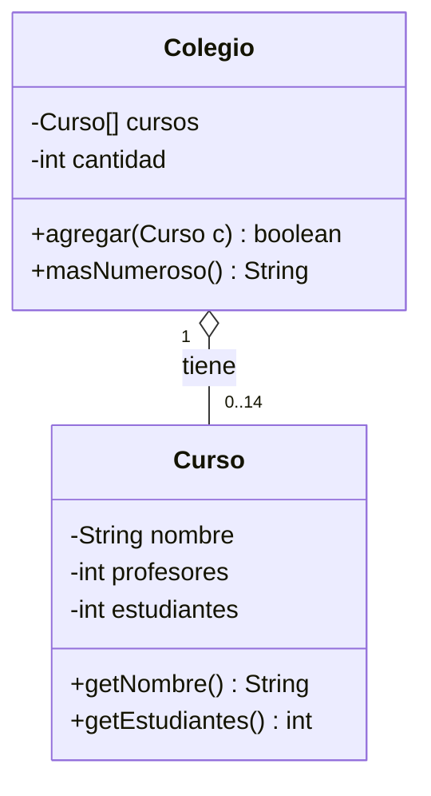

# Día 10 · Matrices e integrador

> [!info] Datos de la clase
> **Semana 2 · Viernes** · **IDE:** BlueJ · **Requisito:** [[Día 09 - Apuntes|Día 9]]
> **Material del día:** [[Día 10 - Diapositivas|Diapositivas]] · [[Día 10 - Práctica|Práctica]] · [[README|Ruta de aprendizaje]]

> [!abstract] Al terminar este día podrás…
> - **Declarar, crear y recorrer** matrices.
> - Calcular **sumas por fila, por columna y totales**.
> - Recorrer **diagonales** y regiones de una matriz cuadrada.
> - Usar una matriz como **atributo** de una clase.
> - Diseñar **clases que colaboran** entre sí (un objeto que guarda otros objetos).
> - Resolver un **problema integrador** con todo lo visto en el curso.

---

### 1. ¿Qué es una matriz?

Una **matriz** es un arreglo de **dos dimensiones**: datos organizados en **filas** y **columnas**. Cada casilla se identifica con **dos** índices: `m[fila][columna]`.

| | col 0 | col 1 | col 2 | col 3 |
|---|---|---|---|---|
| **fila 0** | 5 | 2 | 8 | 1 |
| **fila 1** | 3 | 7 | 4 | 6 |
| **fila 2** | 9 | 0 | 2 | 5 |

`m[1][2]` vale **4** (fila 1, columna 2).

> [!example] ¿Para qué sirve?
> Ventas de 4 agencias × 5 productos · notas de 30 estudiantes × 3 parciales · una imagen como cuadrícula de píxeles · un tablero de juego.

### 2. Declarar y crear

```java
int[][] m = new int[3][4];          // 3 filas, 4 columnas, todo en 0
double[][] ventas = new double[4][5];
int[][] t = {
    {5, 2, 8, 1},
    {3, 7, 4, 6},
    {9, 0, 2, 5}
};
```

| Expresión | Significa | En `t` |
|---|---|---|
| `t.length` | cantidad de **filas** | 3 |
| `t[0].length` | cantidad de **columnas** (de la fila 0) | 4 |
| `t[f][c]` | la casilla de la fila `f`, columna `c` | `t[2][0]` = 9 |

> [!tip] Una matriz es un "arreglo de arreglos"
> `t[1]` es la fila 1 completa: el arreglo `{3, 7, 4, 6}`. Por eso `t[1].length` es 4.

### 3. Recorrer: dos ciclos anidados

Ciclo **externo** para las filas, **interno** para las columnas (como las figuras del [[Día 07 - Apuntes#6. Ciclos anidados|Día 7]]).

```java
// Leer
for (int f = 0; f < m.length; f++) {
    for (int c = 0; c < m[f].length; c++) {
        System.out.print("m[" + f + "][" + c + "] = ");
        m[f][c] = sc.nextInt();
    }
}

// Mostrar como tabla
for (int f = 0; f < m.length; f++) {
    for (int c = 0; c < m[f].length; c++) {
        System.out.print(m[f][c] + "\t");
    }
    System.out.println();
}
```

### 4. Sumas por fila, por columna y total

```java
public int sumaTotal(int[][] m) {
    int s = 0;
    for (int f = 0; f < m.length; f++) {
        for (int c = 0; c < m[f].length; c++) {
            s += m[f][c];
        }
    }
    return s;
}

public int sumaFila(int[][] m, int f) {
    int s = 0;
    for (int c = 0; c < m[f].length; c++) {
        s += m[f][c];
    }
    return s;
}

public int sumaColumna(int[][] m, int c) {
    int s = 0;
    for (int f = 0; f < m.length; f++) {
        s += m[f][c];
    }
    return s;
}
```

> [!important] ¿Qué índice cambia?
> - **Fila fija** `f`: recorre las columnas (`c` cambia).
> - **Columna fija** `c`: recorre las filas (`f` cambia).

### 5. Matrices cuadradas: diagonales y regiones

En una matriz de `n × n`:

| Región | Condición sobre `[f][c]` |
|---|---|
| **Diagonal principal** | <code>f &#61;&#61; c</code> |
| **Diagonal secundaria** | <code>f + c &#61;&#61; n - 1</code> |
| Sobre la diagonal principal | `c > f` |
| Bajo la diagonal principal | `c < f` |
| Borde | <code>f &#61;&#61; 0 &#124;&#124; f &#61;&#61; n - 1 &#124;&#124; c &#61;&#61; 0 &#124;&#124; c &#61;&#61; n - 1</code> |

```text
Diagonal principal (D)     Diagonal secundaria (S)
D . . .                    . . . S
. D . .                    . . S .
. . D .                    . S . .
. . . D                    S . . .
```

```java
public int sumaDiagonalPrincipal(int[][] m) {
    int s = 0;
    for (int i = 0; i < m.length; i++) {
        s += m[i][i];                    // basta UN ciclo
    }
    return s;
}

public int sumaDiagonalSecundaria(int[][] m) {
    int n = m.length, s = 0;
    for (int i = 0; i < n; i++) {
        s += m[i][n - 1 - i];
    }
    return s;
}
```

> [!tip] Recorrer una región
> Para una región cualquiera (triángulo, borde, "parte oscura" de un dibujo), recorre toda la matriz y usa un `if` con la condición de la región. O mejor: ajusta los límites del ciclo interno, como con las figuras del Día 7.

### 6. Otros recorridos

> [!example] Buscar el máximo y su posición
> ```java
> public String maximoConPosicion(int[][] m) {
>     int fMax = 0, cMax = 0;
>     for (int f = 0; f < m.length; f++) {
>         for (int c = 0; c < m[f].length; c++) {
>             if (m[f][c] > m[fMax][cMax]) {
>                 fMax = f;
>                 cMax = c;
>             }
>         }
>     }
>     return m[fMax][cMax] + " en (" + fMax + ", " + cMax + ")";
> }
> ```

> [!example] Transpuesta (filas ↔ columnas)
> ```java
> public int[][] transpuesta(int[][] m) {
>     int[][] t = new int[m[0].length][m.length];
>     for (int f = 0; f < m.length; f++) {
>         for (int c = 0; c < m[f].length; c++) {
>             t[c][f] = m[f][c];
>         }
>     }
>     return t;
> }
> ```
> Rotar una matriz cuadrada 90° a la derecha es: transpuesta y después invertir el orden de las columnas de cada fila.

> [!example] Recorrido en espiral
> Se recorren los **bordes** de afuera hacia adentro, achicando cuatro límites:
> ```java
> public String espiral(int[][] m) {
>     String r = "";
>     int arriba = 0, abajo = m.length - 1;
>     int izq = 0, der = m[0].length - 1;
>     while (arriba <= abajo && izq <= der) {
>         for (int c = izq; c <= der; c++) r += m[arriba][c] + " ";
>         arriba++;
>         for (int f = arriba; f <= abajo; f++) r += m[f][der] + " ";
>         der--;
>         if (arriba <= abajo) {
>             for (int c = der; c >= izq; c--) r += m[abajo][c] + " ";
>             abajo--;
>         }
>         if (izq <= der) {
>             for (int f = abajo; f >= arriba; f--) r += m[f][izq] + " ";
>             izq++;
>         }
>     }
>     return r;
> }
> ```

### 7. Una matriz como atributo

> [!example] Ventas de una comercializadora: 4 agencias × 5 productos
> ```java
> public class Comercializadora {
>     private int[][] cantidades;     // [agencia][producto]
>     private double[] precios;       // [producto]
>
>     public Comercializadora(double[] precios) {
>         this.precios = precios;
>         cantidades = new int[4][precios.length];
>     }
>
>     public void registrar(int agencia, int producto, int cant) {
>         cantidades[agencia][producto] += cant;
>     }
>
>     public double recaudacionAgencia(int a) {
>         double total = 0;
>         for (int p = 0; p < precios.length; p++) {
>             total += cantidades[a][p] * precios[p];
>         }
>         return total;
>     }
>
>     public int totalProducto(int p) {
>         int total = 0;
>         for (int a = 0; a < cantidades.length; a++) {
>             total += cantidades[a][p];
>         }
>         return total;
>     }
> }
> ```
> Observa cómo una **matriz** (cantidades) y un **arreglo** (precios) se combinan: la columna `p` de la matriz corresponde a la posición `p` del arreglo.

> [!note] `this`
> `this.precios` es el **atributo**; `precios` sin `this` es el **parámetro**. Se usa `this` cuando ambos tienen el mismo nombre.

### 8. Clases que colaboran

En lugar de muchos arreglos paralelos, se puede crear una **clase** para cada "cosa" y guardar **objetos** en un arreglo.

```java
public class Curso {
    private String nombre;
    private int profesores;
    private int estudiantes;

    public Curso(String nombre, int profesores, int estudiantes) {
        this.nombre = nombre;
        this.profesores = profesores;
        this.estudiantes = estudiantes;
    }
    public String getNombre() { return nombre; }
    public int getEstudiantes() { return estudiantes; }
    public String toString() {
        return nombre + " (" + estudiantes + " estudiantes, " + profesores + " profesores)";
    }
}
```

```java
public class Colegio {
    private Curso[] cursos = new Curso[14];   // arreglo de OBJETOS
    private int cantidad = 0;

    public boolean agregar(Curso c) {
        boolean ok = cantidad < cursos.length;
        if (ok) {
            cursos[cantidad] = c;
            cantidad++;
        }
        return ok;
    }

    public String masNumeroso() {
        Curso mayor = cursos[0];
        for (int i = 1; i < cantidad; i++) {
            if (cursos[i].getEstudiantes() > mayor.getEstudiantes()) {
                mayor = cursos[i];
            }
        }
        return mayor.getNombre();
    }
}
```



> [!tip] Probar en BlueJ
> Crea varios objetos `Curso` en el banco de objetos. Al llamar a `agregar` en el `Colegio`, BlueJ te deja escribir el **nombre del objeto** `Curso` como argumento.

### 9. Cómo enfrentar un problema integrador

Los problemas grandes (como los de examen) se resuelven con los mismos pasos del [[Día 01 - Apuntes#4. ¿Qué es un algoritmo?|Día 1]], aplicados a clases:

1. **Leer con calma** y subrayar los **sustantivos** (posibles clases y atributos) y los **verbos** (posibles métodos).
2. **Modelar:** dibuja las clases con sus atributos (con tipo) y métodos (con parámetros y retorno).
3. **Elegir las estructuras:** ¿un valor? ¿una lista (arreglo)? ¿una tabla (matriz)? ¿un objeto?
4. **Programar de a un método**, del más simple al más complejo, y **probar cada uno** en BlueJ.
5. **Prueba de escritorio** de los métodos con ciclos, con un ejemplo pequeño.
6. Al final, el `main` (si lo piden) que lee, llama y muestra.

---

## Resumen

> [!summary] Lo esencial del Día 10
> - `int[][] m = new int[filas][columnas];` · `m.length` filas · `m[0].length` columnas · `m[f][c]`.
> - Recorrer: dos `for` anidados, filas afuera y columnas adentro.
> - Fila fija → cambian las columnas; columna fija → cambian las filas.
> - Diagonal principal <code>f &#61;&#61; c</code>; secundaria <code>f + c &#61;&#61; n - 1</code>.
> - Una matriz puede ser atributo y combinarse con arreglos.
> - Clases que colaboran: un arreglo de **objetos** + contador reemplaza a muchos arreglos paralelos.
> - Problema grande: sustantivos → clases, verbos → métodos, un método a la vez.

## Siguiente paso

- ✍️ Practica: [[Día 10 - Práctica]]
- 📖 Glosario: [[Glosario]]
- ⬅️ Ayer: [[Día 09 - Apuntes|Día 9 · Arreglos]]
- 🏁 ¡Terminaste la teoría! Siguen las semanas de **resolución de ejercicios** ([[README|ruta]]).
